# Audit Data Organisasi ALIM Core untuk Integrasi ALIM Connect

> **Status:** audit dan dokumentasi saja. Tidak ada perubahan kode, database, migration, endpoint, maupun konfigurasi.
>
> **Prinsip:** seluruh temuan di bawah ini diverifikasi dari implementasi aktual repository (model, migration, controller, route, service, seeder). Bila dokumentasi lama berbeda, implementasi aktual yang dipakai dan perbedaannya dicatat pada §14.

## 1. Ringkasan Hasil Audit

ALIM Core **sudah memiliki** struktur organisasi yang cukup kaya, tetapi tidak berbentuk satu pohon organisasi tunggal. Struktur tersebut tersebar pada empat lapis yang harus dibedakan:

| Lapis | Entitas aktual | Fungsi |
|---|---|---|
| Unit organisasi | `work_units` | Satuan kerja/unit, berjenjang lewat `parent_id`, bertipe, terhubung ke `divisis` dan `domains` |
| Unit akademik | `schools`, `grade_levels`, `study_groups`, `academic_years` | Satuan pendidikan, jenjang, rombongan belajar, tahun ajaran |
| Master jabatan | `structural_positions`, `jenis_gtk`, `additional_task_types` | Katalog jabatan struktural, kategori GTK, master tugas tambahan |
| Penugasan | `structural_assignments`, `gtk_work_unit`, `gtk_additional_tasks`, `other_teacher_tasks`, `teaching_assignments`, `homeroom_assignments`, `coordinator_assignments`, `dormitory_staff_assignments`, `room_supervisors` | Siapa ditugaskan di mana, untuk apa, dan sampai kapan |

Kesimpulan utama:

1. **`work_unit` adalah unit organisasi utama**, bukan `jabatan`. `jabatan` adalah katalog posisi (`structural_positions`) atau label pada penugasan.
2. **`school` adalah unit yang dipakai untuk pembatasan data akademik.** Hampir semua data akademik (tahun ajaran, rombel, mapel, santri, SK, penugasan mengajar) berelasi ke `school_id`, bukan langsung ke `work_unit_id`.
3. **Satu akun dapat memiliki beberapa penugasan** melalui `gtk_work_unit` (unique per user+unit), `structural_assignments` (unique per user+position+school+academic year), dan tugas tambahan. Tidak ada batas satu unit per user.
4. **Permission tidak diturunkan langsung dari jabatan.** Permission dihitung dari role Spatie dan/atau domain yang melekat pada posisi struktural yang ditugaskan (`structural_positions.domain_id`), lalu di-cache dalam `permission_snapshots` per `scope_key`.
5. **API integrasi yang ada (POS dan Recruitment) hanya menyediakan sebagian data.** Tidak ada endpoint untuk `structural_assignments`, hierarki unit penuh, riwayat penugasan, masa berlaku, SK, rumpun, atau change feed. Detail gap ada di §9.
6. **Tidak ada entitas `yayasan` atau `pesantren` sebagai tabel tersendiri.** Keduanya hanya muncul sebagai nilai `level` pada `structural_positions` (tetapi seeder mengisi semua `pondok`), sebagai status kepegawaian (`PTY`/`GTY`), atau sebagai teks pada dokumen. Ini harus dinyatakan eksplisit kepada ALIM Connect.
7. **Tidak ada tabel `positions` aktif.** Tabel lama `positions` sudah di-merge ke `structural_positions` dan di-drop. Model `App\Models\Position` masih ada tetapi menunjuk ke tabel yang sudah tidak ada (stale).

## 2. Arsitektur dan Sumber Data Organisasi

### 2.1 Stack dan lokasi pengelolaan

- Framework: Laravel 12 (`php artisan --version` → `Laravel Framework 12.70.1`).
- Database: migration menggunakan UUID untuk seluruh entitas organisasi; mendukung MySQL dan SQLite (beberapa migration memiliki cabang driver).
- Autentikasi web: session + Spatie Permission (`spatie/laravel-permission`).
- Autentikasi API mobile: Sanctum (`auth:sanctum`) dengan ability per endpoint.
- Autentikasi API integrasi: **static API key per aplikasi** (POS, Recruitment), bukan OAuth dan bukan akun pengguna.

### 2.2 Sumber pengelolaan (UI web)

| Data | Route/Controller utama |
|---|---|
| Work unit (satuan kerja) | `routes/web.php` blok `work-units`; `App\Http\Controllers\WorkUnitController` |
| Divisi/bagian | `routes/web.php` blok `divisi`; `App\Http\Controllers\DivisiController` |
| Sekolah/satuan pendidikan | `routes/web.php` blok `schools`; `SchoolController`, `SchoolUnitController` |
| Jabatan per satuan | `SatuanPositionController` (`/schools/{schoolId}/jabatan`) |
| GTK / kepegawaian | `GtkWizardController`, `PersonaliaController`, halaman Data GTK |
| Kepala & wakil unit | `GtkUnitHeadController` (`/kepala-wakil`), `App\Support\GtkUnitHeadAssignment` |
| SK / decree | `InstitutionDecreeController` (`/institution-decrees`) |
| Usulan jabatan | `PositionProposalController` |
| Asrama | `Dormitory*Controller`, `dormitory_staff_assignments` |
| Tugas tambahan | `GtkAdditionalTask`, `OtherTeacherTask`, master `additional_task_types` |
| Rumpun mapel | `SubjectGroup`, halaman Master Rumpun (Kurikulum) |

### 2.3 Batas domain dan multi-unit

ALIM Core **tidak memakai `work_unit_id` sebagai scope tunggal** untuk seluruh data. Scope aktual dibentuk oleh:

- `OrganizationContext(schoolId, academicYearId, roleDimension, tenant)` — `app/Authorization/ValueObjects/OrganizationContext.php`.
- `BindOrganizationContext` — `app/Http/Middleware/BindOrganizationContext.php`, mengisi context dari request attribute `schoolContextId` (di-set `SchoolContextMiddleware`), session tahun ajaran, lalu config default.
- `SchoolContextMiddleware` — `app/Http/Middleware/SchoolContextMiddleware.php`, menentukan `schoolContext`, `schoolContextId`, dan `isGlobalView`.
- `SchoolGroupService::getUserSchool()` — `app/Services/SchoolGroupService.php:266`, urutan resolusi:
  1. `gtk_employments.school_id`
  2. `schools.principal_user_id`
  3. `gtk_work_unit.work_unit_id` → `schools.work_unit_id`
- Global view hanya bila user punya permission `view_global_school_data` (`SchoolGroupService::userCanGlobalView()`).

Implikasi: **satu unit akademik = satu `school`**, sedangkan **satu unit organisasi = satu `work_unit`**. Relasi `schools.work_unit_id` menghubungkan keduanya, tetapi satu `work_unit` secara skema dapat memiliki lebih dari satu `school` (lihat §14).

## 3. Daftar Entitas dan Tabel Terkait

### 3.1 Unit organisasi

#### `work_units`

Primary key: `id` (UUID).

Kolom penting:

| Kolom | Tipe | Keterangan |
|---|---|---|
| `name` | string | Nama unit |
| `code` | string unique | Kode unit; dibuat dari prefix divisi + nomor (`WorkUnit::generateUniqueCode`) |
| `type` | varchar | Semula enum 6 nilai; diubah ke varchar oleh `2026_07_31_120800_alter_work_units_add_health_type.php` agar `Pelayanan Kesehatan` dapat dipakai |
| `parent_id` | uuid nullable | Relasi diri ke `work_units.id`; **tidak ada foreign key constraint** di migration awal |
| `divisi_id` | uuid nullable FK `divisis` | Bagian/bidang pemilik unit |
| `domain_id` | uuid nullable FK `domains` | Domain permission workspace unit |
| `is_active` | boolean | Status aktif |
| `metadata` | json nullable | Termasuk `head_user_id` yang dibaca `User::headedWorkUnitIds()` |
| `created_at`, `updated_at`, `deleted_at` | timestamp | Soft delete |

Model: `App\Models\WorkUnit`. Relasi: `parent()`, `children()`, `school()` (hasOne), `schools()` (hasMany), `divisi()`, `domain()`, `gtkWorkUnits()`, `dormitories()`, `sarprasOfficers()`. Boot model menulis `audit_logs` untuk create/update/delete. Tipe yang dikenal model: `Unsur Pimpinan`, `Unit Akademik`, `Unit Penunjang Akademik`, `Unit Administrasi`, `Unit Pelayanan`, `Unit Humas Publikasi`, `Pelayanan Kesehatan`.

Catatan: `fillable` memuat `induk`, tetapi migration aktif tidak membuat kolom `induk` (hanya ada di `database/migrations/backup_migrations/`). Ini warisan yang tidak boleh diandalkan.

#### `divisis`

Primary key: `id` (UUID).

Kolom: `nama` (150), `kode` (30, unique), `deskripsi`, `is_active`, `sort_order` (ditambahkan `2026_04_27_104423_add_sort_order_to_divisis_table.php`), timestamps, `deleted_at`.

Model: `App\Models\Divisi` — hanya relasi `dokumenIso()`; **tidak ada relasi `workUnits()`** meskipun `work_units.divisi_id` ada. `sort_order` tidak masuk `$fillable` walau dibaca controller.

Seeder `DivisiSeeder` mengisi 13 divisi (Satuan Pendidikan, Pengasuhan, Tahfidz, Bahasa, Perpustakaan, Laboratorium, UKS, Rumah Tangga, Keamanan, Gizi, TI, Keuangan, Humas).

#### `schools`

Primary key: `id` (UUID). Foreign key: `work_unit_id` → `work_units.id` (cascade delete).

Kolom penting: `npsn` (unique), `nss`, `name`, `address`, kode wilayah, `school_level` (`sd|smp|sma|smk`), `school_status`, `school_gender` (ditambahkan `2026_04_08_100000_add_school_gender_to_schools_table.php`), `boarding_type`, `principal_user_id`, `principal_name`, `principal_nip`, `is_active`, `logo_path`.

Model: `App\Models\School`. Relasi: `workUnit()`, `principalUser()`, `province/city/district/village()`, `operationalLinks()`, `primaryLinks()`. Scope: `active()`, `level()`.

#### `domains` dan `domain_role_permissions`

- `domains`: `id`, `code` (unique), `name`, `description`, `is_active`.
- `domain_role_permissions`: `id`, `domain_id`, `permission_id`, unique `(domain_id, permission_id)`.
- Seeder `DomainSeeder` mengisi 14 domain resmi dan mengklaim sejajar dengan role inti; `RoleSeeder` aktual berisi 16 role inti, sehingga jumlahnya tidak persis sama.
- Model: `App\Models\Domain` (`positions()` hasMany `StructuralPosition`, `permissions()` belongsToMany), `App\Models\DomainPermission`.

### 3.2 Master jabatan dan kategori GTK

#### `structural_positions`

Primary key: `id` (UUID).

Kolom: `code` (50, unique), `name` (100), `level` (50; komentar migration: yayasan/pondok/madrasah), `hierarchy_level` (integer; 1 tertinggi), `description`, `is_active`, `jenis_gtk_id` (FK `jenis_gtk`), `role_id` (FK `roles`, nullable), `kategori` (nullable), `urutan` (default 0), `domain_id` (FK `domains`, nullable; ditambahkan `2026_09_16_000003`), timestamps.

Model: `App\Models\StructuralPosition`. Relasi: `jenisGtk()`, `role()`, `domain()`, `assignments()`, `activeAssignments()` (status active + rentang tanggal). Scope `active()`.

Sumber data: `database/seeders/JenisGtkSeeder.php` membuat posisi dari 14 kategori `jenis_gtk`. **Seeder ini menghapus seluruh `structural_positions` sebelum mengisi ulang** (`StructuralPosition::query()->delete()`), sehingga aman hanya untuk instalasi awal. Karena `structural_assignments.position_id` memakai `cascadeOnDelete`, menjalankan seeder di data produksi berpotensi **menghapus seluruh assignment struktural** dan mengganti UUID posisi. Semua posisi hasil seeder memakai `level = 'pondok'`, `hierarchy_level = 5`, `kategori = 'Jabatan'`.

Catatan penting: `$fillable` pada model `StructuralPosition` **tidak memuat `domain_id`**. `JenisGtkSeeder` mengirim `domain_id` melalui `updateOrCreate()`, sehingga nilai tersebut berpotensi diabaikan oleh mass-assignment. Akibatnya, `domain_id` pada posisi hasil seeder bisa null dan permission berbasis domain tidak terbentuk. Data ini harus diverifikasi sebelum dipakai untuk integrasi (lihat R17).

#### `jenis_gtk`

Primary key: `id` (UUID). Kolom: `nama`, `deskripsi`, `is_active`, `urutan`. Ini **kategori GTK**, bukan jabatan dan bukan unit. Relasi: `jabatans()`/`activeJabatans()` ke `StructuralPosition`.

#### `additional_task_types`

Primary key: `id` (UUID). Kolom: `jenis_gtk_id`, `nama`, `kode`, `deskripsi`, `urutan`, `is_active`. Model: `App\Models\AdditionalTaskType` (`jenisGtk()`, scope `active()`). Seeder mengisi antara lain Wali Kelas, Wali Kamar, Koordinator Kurikulum, Tim Kurikulum, Tim Kesiswaan, Bendahara Sekolah.

#### `positions` (usang)

Tabel `positions` dibuat lewat rename dari `jabatan` (`2026_08_01_000001_rename_jabatan_to_positions_table.php`), lalu di-merge ke `structural_positions` dan **di-drop** (`2026_09_03_154500_merge_positions_to_structural_positions_table.php`). Model `App\Models\Position` masih ada dan menunjuk `protected $table = 'positions'`; **jangan dipakai**.

### 3.3 GTK dan identitas pengguna

#### `users`

Primary key: `id` (UUID). Kolom organisasi yang relevan: `is_active`, `is_system_admin`, `is_permanent`, `name`, `username`, `email`, `last_login_at`, `deleted_at`.

Model: `App\Models\User` memakai `HasRoles` (Spatie), `HasApiTokens` (Sanctum), `SoftDeletes`.

Relasi kunci:

| Relasi | Tipe | Tujuan |
|---|---|---|
| `gtkProfile()` | hasOne | `gtk_profiles` |
| `employment()` | hasOne | `gtk_employments` (record utama) |
| `employments()` | hasMany | seluruh record kepegawaian (de facto riwayat) |
| `gtkWorkUnits()` | hasMany | `gtk_work_unit` (penempatan multi-unit) |
| `primaryWorkUnit()` | hasOne | `gtk_work_unit` dengan `is_primary = true` |
| `additionalTasks()` / `tugasTambahan()` | hasMany | `gtk_additional_tasks` (aktif bila `tst` kosong/≥ hari ini) |
| `workUnitHistories()` | hasMany | `gtk_work_unit_histories` |
| `activeAssignments()` | query | `StructuralAssignment::active()` |
| `activeDomainIds()` / `activeDomains()` | query | domain dari assignment aktif |
| `effectivePermissionNames()` | method | union permission Spatie + domain assignment |
| `headedWorkUnitIds()` | method | unit yang dipimpin (kepala sekolah, kepala asrama, jabatan `KEPALA%`, `metadata->head_user_id`) |
| `roomSupervisors()` / `activeRoomSupervisions()` | hasMany | wali kamar |

#### `gtk_profiles`

Primary key: `id` (UUID). `user_id` unique FK `users`. Berisi data pribadi: `nik`, `no_kk`, tempat/tanggal lahir, nama ibu, golongan darah, jenis kelamin, agama, dan atribut lain. Relasi: `user()`, alamat, keluarga, `latestEmployment()`.

#### `gtk_employments`

Primary key: `id` (UUID).

Kolom: `user_id` FK, `status_kepegawaian` (enum: `PTT`, `PTY`, `Percobaan`, `Magang`, `GTT`, `GTY`, `KONTRAK`, `Berhenti`, `Wafat`, `Pensiun`), `nupy` unique nullable, `satuan_kerja` (string), `jenis_gtk` (string), `jabatan` (string), `tmt`, `nomor_sk`, `tanggal_sk`, `pangkat_golongan`; tambahan `school_id`, `academic_year_id`, `study_group_id`, `position_type`, `is_homeroom`, `decree_number`, `decree_date`, `jenis_gtk_id`, `jabatan_id` (FK `structural_positions`).

Model: `App\Models\GtkEmployment`. Relasi: `user()`, `school()`, `academicYear()`, `studyGroup()`, `jenisGtk()`, `jabatanRel()`. `STATUS_LABELS` hanya memuat 7 status; `Berhenti`, `Wafat`, `Pensiun` ada di enum tetapi tidak punya label tampilan.

Catatan penting: meskipun `User::employment()` adalah `hasOne`, tabel **tidak memiliki unique constraint pada `user_id`**, sehingga secara data bisa ada banyak baris. `employments()` dipakai sebagai riwayat.

Observer `App\Observers\GtkEmploymentObserver`:
- `created` / perubahan `jabatan_id` → `syncRoles()`: memilih `StructuralAssignment` aktif lebih dulu, fallback ke `employment.jabatan_id`, lalu `syncRoles()` (replace seluruh role user).
- perubahan `jabatan`, `jenis_gtk`, `status_kepegawaian` → notifikasi ke user.
- `deleted` → memanggil `removeGtkRolesIfOrphaned()`, tetapi implementasinya saat ini hanya menyinkronkan ulang daftar role yang sama (`$remaining = $currentRoles; syncRoles($remaining)`); role **belum tentu benar-benar dicabut** saat employment dihapus.

#### `gtk_work_unit`

Primary key: `id` (UUID). Unique `(user_id, work_unit_id)`.

Kolom: `user_id`, `work_unit_id`, `jabatan` (teks), `position_id` (FK `structural_positions`, nullable; ditambahkan `2026_10_29_180100`), `is_primary`, timestamps.

Model: `App\Models\GtkWorkUnit`. Relasi: `user()`, `workUnit()`, `position()`. Scope: `primary()`, `byWorkUnit()`, `byUser()`.

Ini adalah tabel **penempatan GTK pada unit** dan sumber utama "satu akun, banyak unit". `is_primary` menandai unit utama, tetapi tidak ada constraint yang menjamin hanya satu baris `is_primary` per user.

#### `gtk_work_unit_histories`

Primary key: `id` (UUID). Kolom: `user_id`, `from_work_unit_id` nullable, `to_work_unit_id`, `jabatan`, `action` (`ASSIGN|TRANSFER|REMOVE`), `reason`, `performed_by`, `ip_address`, `user_agent`, timestamps.

Ditulis oleh `PersonaliaController` (sekitar baris 277 dan 361), `GtkTransferRequest` (baris 202), dan `CandidateConversionService` (baris 238). Ini adalah **riwayat perpindahan unit**, bukan riwayat jabatan struktural.

### 3.4 Penugasan struktural dan SK

#### `structural_assignments`

Primary key: `id` (UUID).

Kolom: `user_id` FK, `position_id` FK, `school_id` FK, `academic_year_id` FK, `decree_id` nullable FK `institution_decrees` (semula NOT NULL; diubah `2026_09_22_051202_make_decree_id_nullable_in_structural_assignments_table.php`), `additional_info`, `start_date`, `end_date` nullable, `status` (`active|inactive|ended`), `notes`, timestamps, `deleted_at`.

Unique: `(user_id, position_id, academic_year_id, school_id)`. Indeks: user, position, school, academic year, status.

Model: `App\Models\StructuralAssignment`. Relasi: `user()`, `position()`, `school()`, `academicYear()`, `decree()`. Scope `active()` = `status = active` AND `start_date <= today` AND (`end_date` null OR `end_date >= today`).

Ini adalah **assignment jabatan struktural berbasis SK/sekolah/tahun ajaran**, bukan penempatan unit (`gtk_work_unit`) dan bukan tugas tambahan.

Pembentukan data (tidak ada CRUD khusus):
- `GtkWizardController::assignWorkUnit()` / `refreshStructuralAssignment()` — `updateOrCreate` saat GTK dibuat/diubah; mengisi `decree_id` null, `start_date = today`.
- `App\Support\GtkUnitHeadAssignment::syncStructuralAssignment()` — saat kepala/wakil unit ditetapkan; `endStructuralAssignment()` menandai `inactive` + `end_date` saat dilepas.

#### `institution_decrees`

Primary key: `id` (UUID). Kolom: `decree_number` unique, `decree_type`, `title`, `description`, `academic_year_id` FK, `issued_date`, `effective_date`, `end_date`, `signed_by` FK users nullable, `signed_position`, `document_path`, `document_filename`, `status` (`draft|active|archived`), timestamps, `deleted_at`.

Dikelola `InstitutionDecreeController` (`/institution-decrees`: index, create, store, import, show, print, edit, update, destroy). SK dipakai oleh `structural_assignments`, `teaching_assignments`, `homeroom_assignments`, `coordinator_assignments`, `gtk_additional_tasks`, dan `other_teacher_tasks`.

### 3.5 Tugas tambahan dan tim operasional

#### `gtk_additional_tasks` (legacy, level user)

Primary key: `id` (UUID). Kolom: `user_id`, `decree_id`, `work_unit_id`, `additional_task_type_id`, `nama_tugas`, `hours_per_week`, `nomor_sk` (terenkripsi accessor), `tmt`, `tst`, timestamps.

Model: `App\Models\GtkAdditionalTask`. Relasi: `user()`, `decree()`, `workUnit()`, `additionalTaskType()`. `is_active` dihitung: `tst` kosong atau `tst >= now()`.

#### `other_teacher_tasks` (utama untuk tim/rumpun per sekolah)

Primary key: `id` (UUID). Kolom: `teacher_id`, `school_id`, `academic_year_id`, `decree_id`, `additional_task_type_id`, `study_group_id` nullable, `work_unit_id`, `task_name`, `task_code`, `weekly_hours`, `notes`, `is_active`, timestamps.

Model: `App\Models\OtherTeacherTask`. Relasi: `teacher()`, `school()`, `academicYear()`, `decree()`, `studyGroup()`, `workUnit()`, `additionalTaskType()`.

Per changelog (`docs/CHANGELOG-2026-10.md`, butir 28), `other_teacher_tasks` adalah **sumber utama koordinator rumpun per satuan pendidikan**; `gtk_additional_tasks` dibaca sebagai kompatibilitas legacy.

#### `coordinator_assignments`

Primary key: `id` (UUID). Kolom: `decree_id`, `teacher_id`, `coordination_area` (string), `coordination_type` (string nullable), `school_id`, `academic_year_id`, `start_date`, `end_date`, `status`, `description`, `responsibilities`, timestamps, `deleted_at`. Unique `(decree_id, teacher_id, coordination_area)`.

Catatan: `coordination_area` adalah **teks bebas**, bukan FK ke unit/rumpun. Ini berbeda dari `other_teacher_tasks` yang punya `work_unit_id` dan master tugas.

#### `dormitory_staff_assignments`

Primary key: `id` (UUID). Kolom: `user_id`, `dormitory_id`, `assigned_by_id`, `start_date`, `end_date`, `status`, `position` (slug legacy), `position_id` (FK `structural_positions`), `shift`, `duties` (json), `nomor_sk`, `tmt`, `tst`, `notes`, `updated_by_id`, timestamps, `deleted_at`.

Relasi: `user()`, `structuralPosition()` (sengaja tidak dinamai `position` agar tidak bertabrakan dengan kolom legacy `position`), `taskTypes()` (belongsToMany `additional_task_types` via `dormitory_staff_assignment_tasks`).

#### Tim/kelompok operasional lain

- `WorkUnitSarprasOfficer` — petugas sarpras per unit; relasi `WorkUnit::sarprasOfficers()`, `primarySarprasOfficer()`.
- `CleaningAssignment` — petugas kebersihan per area, dengan `user_id`, `backup_user_id`, `supervisor_id`, `is_active`.
- `RoomSupervisor` — wali kamar (`user_id`, status, `start_date`, `end_date`); `User::activeRoomSupervisions()`.
- `DormitoryWing.supervisor_id`, `Dormitory.head_id` — penanggung jawab asrama/sayap.
- `SubjectGroup` + `other_teacher_tasks` — rumpun mapel dan koordinatornya.

**Tidak ada tabel generik `teams` atau `team_members`.** "Tim" direpresentasikan sebagai kumpulan tugas tambahan (`additional_task_types` + `other_teacher_tasks`/`gtk_additional_tasks`) atau assignment khusus per modul.

### 3.6 Rumpun/kelompok kerja

`subject_groups`:

- `id` UUID, `code` unique, `name`, `coordinator_task_name`, `patterns` json, `sort_order`, `is_active`.
- Keanggotaan mapel: `subjects.subject_group_id` (ditambahkan `2026_10_09_240000_create_subject_groups_and_link_subjects.php`).
- Model: `App\Models\SubjectGroup` (`subjects()`).
- Koordinator: dicari dari `other_teacher_tasks` berdasarkan `task_name` yang cocok dengan `coordinator_task_name`; logika di `App\Services\SubjectGroupResolver` (dipakai kebijakan bank soal/RPM).
- Rumpun **bukan unit organisasi** dan tidak memiliki `work_unit_id`/`school_id` sendiri; scope-nya melekat pada mapel dan penugasan koordinator per sekolah/tahun ajaran.

### 3.7 Relasi akademik

- `academic_years`: `id`, `school_id`, `name`, `semester` (`ganjil|genap`), `is_active`, `start_date`, `end_date`, registration window. Unique `(school_id, name, semester)`.
- `grade_levels`: `id`, `school_id`, `level` (int), `name`, `code`, `is_active`. Unique `(school_id, level)`.
- `study_groups` (rombel): `id`, `school_id`, `academic_year_id`, `grade_level_id`, `homeroom_teacher_id`, `name`, `code`, `capacity`, `room`, `curriculum_type`, `shift`, `is_active`; tambahan `unit_type`, `data_owner_school_id`.
- `subjects`: `id`, `school_id` (per sekolah), `name`, `subject_group_id`, dan atribut kurikulum lain.
- `students`: `id`, `school_id`, dan atribut identitas; kelas berjalan dibaca dari `student_class_histories` (`Student::currentClassHistory`).
- `student_class_histories`: relasi santri ke `study_group_id` per `academic_year_id`.

### 3.8 Penugasan akademik

- `teaching_assignments`: `decree_id`, `teacher_id` (users), `school_id`, `academic_year_id`, `study_group_id`, `subject_id`, `role` (`guru_mapel|guru_pendamping|guru_praktik|ustadz_pengasuh`), `is_coordinator`, `weekly_hours`, `status`, `assignment_source`, `gtk_cross_unit_assignment_id`. Unique `(decree_id, teacher_id, study_group_id, subject_id)`.
- `homeroom_assignments`: `decree_id`, `teacher_id`, `study_group_id`, `school_id`, `academic_year_id`, `start_date`, `end_date`, `status`. Unique `(decree_id, study_group_id)`.
- `study_groups.homeroom_teacher_id` juga menyimpan wali kelas (duplikasi terkontrol dengan `homeroom_assignments`).
- `coordinator_assignments`: koordinator per area teks.
- `gtk_cross_unit_assignments`: penugasan lintas unit (`user_id`, `home_work_unit_id`, `school_id`, `academic_year_id`, `subject_id`, `decree_number`, rentang tanggal, status). Dipakai untuk guru yang mengajar di sekolah lain dari unit asalnya.

### 3.9 Entitas yang TIDAK ada

Dinyatakan eksplisit agar ALIM Connect tidak mengasumsikan:

| Konsep yang diminta | Status aktual |
|---|---|
| Yayasan | Tidak ada tabel/model. Hanya nilai `level` yang direncanakan dan status kepegawaian `PTY`/`GTY` |
| Pondok pesantren | Tidak ada tabel/model. `level` posisi hasil seeder justru `pondok`, tetapi tidak ada entitas pesantren |
| Bagian/bidang | Tidak ada entitas khusus. Yang ada `divisis` (divisi) dan `work_units` bertipe `Unit Administrasi`/`Unit Pelayanan` |
| Rumpun/kelompok kerja | Ada `subject_groups` (rumpun mapel), bukan rumpun organisasi/unit |
| Tim operasional generik | Tidak ada tabel `teams`/`team_members`; direpresentasikan lewat tugas tambahan dan assignment per modul |
| `positions` | Tabel sudah di-drop; model `Position` stale |
| `DelegatedAssignment` | Tidak ada (hanya disebut di dokumen desain) |
| `ActingPositionAssignment` (PLH/PLT) | Tidak ada |
| `config/positions.php` | Tidak ada |
| Riwayat jabatan struktural | Tidak ada tabel riwayat khusus; hanya `structural_assignments` dengan `status`/tanggal dan soft delete |
| Endpoint API organisasi eksternal | Belum ada (lihat §9) |

## 4. Diagram Relasi ERD

```mermaid
erDiagram
    DIVISIS ||--o{ WORK_UNITS : "divisi_id"
    DOMAINS ||--o{ WORK_UNITS : "domain_id"
    WORK_UNITS ||--o{ WORK_UNITS : "parent_id"
    WORK_UNITS ||--o{ SCHOOLS : "work_unit_id"
    WORK_UNITS ||--o{ GTK_WORK_UNIT : "work_unit_id"
    USERS ||--o{ GTK_WORK_UNIT : "user_id"
    USERS ||--o| GTK_PROFILES : "user_id"
    USERS ||--o{ GTK_EMPLOYMENTS : "user_id"
    SCHOOLS ||--o{ GTK_EMPLOYMENTS : "school_id"
    ACADEMIC_YEARS ||--o{ GTK_EMPLOYMENTS : "academic_year_id"

    JENIS_GTK ||--o{ STRUCTURAL_POSITIONS : "jenis_gtk_id"
    ROLES ||--o{ STRUCTURAL_POSITIONS : "role_id"
    DOMAINS ||--o{ STRUCTURAL_POSITIONS : "domain_id"
    DOMAINS ||--o{ DOMAIN_ROLE_PERMISSIONS : "domain_id"
    PERMISSIONS ||--o{ DOMAIN_ROLE_PERMISSIONS : "permission_id"

    STRUCTURAL_POSITIONS ||--o{ STRUCTURAL_ASSIGNMENTS : "position_id"
    USERS ||--o{ STRUCTURAL_ASSIGNMENTS : "user_id"
    SCHOOLS ||--o{ STRUCTURAL_ASSIGNMENTS : "school_id"
    ACADEMIC_YEARS ||--o{ STRUCTURAL_ASSIGNMENTS : "academic_year_id"
    INSTITUTION_DECREES ||--o{ STRUCTURAL_ASSIGNMENTS : "decree_id"
    STRUCTURAL_POSITIONS ||--o{ GTK_WORK_UNIT : "position_id"

    SCHOOLS ||--o{ ACADEMIC_YEARS : "school_id"
    SCHOOLS ||--o{ GRADE_LEVELS : "school_id"
    SCHOOLS ||--o{ STUDY_GROUPS : "school_id"
    ACADEMIC_YEARS ||--o{ STUDY_GROUPS : "academic_year_id"
    GRADE_LEVELS ||--o{ STUDY_GROUPS : "grade_level_id"
    USERS ||--o{ STUDY_GROUPS : "homeroom_teacher_id"
    SCHOOLS ||--o{ SUBJECTS : "school_id"
    SUBJECT_GROUPS ||--o{ SUBJECTS : "subject_group_id"

    INSTITUTION_DECREES ||--o{ TEACHING_ASSIGNMENTS : "decree_id"
    STUDY_GROUPS ||--o{ TEACHING_ASSIGNMENTS : "study_group_id"
    SUBJECTS ||--o{ TEACHING_ASSIGNMENTS : "subject_id"
    USERS ||--o{ TEACHING_ASSIGNMENTS : "teacher_id"
    INSTITUTION_DECREES ||--o{ HOMEROOM_ASSIGNMENTS : "decree_id"
    STUDY_GROUPS ||--o{ HOMEROOM_ASSIGNMENTS : "study_group_id"
    USERS ||--o{ HOMEROOM_ASSIGNMENTS : "teacher_id"
    INSTITUTION_DECREES ||--o{ COORDINATOR_ASSIGNMENTS : "decree_id"
    USERS ||--o{ COORDINATOR_ASSIGNMENTS : "teacher_id"

    ADDITIONAL_TASK_TYPES ||--o{ GTK_ADDITIONAL_TASKS : "additional_task_type_id"
    USERS ||--o{ GTK_ADDITIONAL_TASKS : "user_id"
    ADDITIONAL_TASK_TYPES ||--o{ OTHER_TEACHER_TASKS : "additional_task_type_id"
    USERS ||--o{ OTHER_TEACHER_TASKS : "teacher_id"
    SCHOOLS ||--o{ OTHER_TEACHER_TASKS : "school_id"

    USERS ||--o{ GTK_WORK_UNIT_HISTORIES : "user_id"
    USERS ||--o{ ROOM_SUPERVISORS : "user_id"
    DORMITORIES ||--o{ DORMITORY_STAFF_ASSIGNMENTS : "dormitory_id"
    USERS ||--o{ DORMITORY_STAFF_ASSIGNMENTS : "user_id"
    STRUCTURAL_POSITIONS ||--o{ DORMITORY_STAFF_ASSIGNMENTS : "position_id"
    DORMITORIES ||--o{ DORMITORY_WINGS : "dormitory_id"

    USERS ||--o{ PERMISSION_SNAPSHOTS : "user_id"
```



Catatan: `permission_snapshots` hanya menyimpan `user_id` dan `scope_key`; permission di dalamnya adalah JSON hasil resolusi, sehingga tidak memiliki FK langsung ke `permissions`.

Catatan ERD:

- `users ||--o{ gtk_employments` digambarkan many-to-one dari sisi user karena tabel tidak unik per user, meskipun relasi Eloquent `employment()` adalah `hasOne`.
- `structural_assignments.decree_id` nullable; garis SK bersifat opsional.
- `gtk_employments` juga memiliki `jabatan_id` ke `structural_positions` (tidak digambar agar tidak membingungkan dengan assignment).
- `students` tidak digambar detail; relasinya `school_id` dan `student_class_histories.study_group_id`.

## 5. Penjelasan Hierarki Organisasi

### 5.1 Hierarki unit (`work_units`)

Hierarki aktual dibentuk oleh `work_units.parent_id` (self-reference). Model menyediakan:

- `parent()` — belongsTo `WorkUnit`
- `children()` — hasMany `WorkUnit`
- scope `active()`, `byType()`, `inactive()`

Tidak ada fungsi dedicated untuk mengambil seluruh pohon (recursive CTE/service). API POS hanya mengembalikan `induk` satu level (`parent:id,name`); ALIM Connect harus membangun pohon sendiri atau meminta endpoint tree (usulan §10).

Nilai `type` yang dikenal: `Unsur Pimpinan`, `Unit Akademik`, `Unit Penunjang Akademik`, `Unit Administrasi`, `Unit Pelayanan`, `Unit Humas Publikasi`, `Pelayanan Kesehatan`.

Catatan implementasi: `WorkUnit::PARENT_OPTIONS` masih berisi string `MUDIR`, `WADIR 1`, `WADIR 2`, sedangkan `parent_id` adalah UUID. Opsi ini tampaknya warisan UI lama dan tidak konsisten dengan relasi aktual. Jangan dipakai sebagai dasar integrasi.

### 5.2 Hierarki jabatan (`structural_positions`)

Dua kolom mengukur hierarki:

- `level` — string bebas; komentar migration menyebut `yayasan`, `pondok`, `madrasah`.
- `hierarchy_level` — integer, 1 = tertinggi.

Namun **data seeder mengisi seluruh posisi dengan `level = 'pondok'` dan `hierarchy_level = 5`** (`JenisGtkSeeder` baris ~371–382). Migration merge posisi lama memakai `hierarchy_level = 5` untuk `kategori = 'Jabatan'`, `20` untuk `kategori = 'Tugas Tambahan'`, dan `10` untuk lainnya.

Konsekuensi: ALIM Connect **tidak boleh** mengandalkan `hierarchy_level` sebagai urutan jabatan yang sudah terisi benar. Nilai ini hanya dapat dipakai bila admin mengisinya eksplisit; jika tidak, urutan harus diambil dari `urutan` per `jenis_gtk` atau dari relasi atasan-bawahan yang belum tersedia.

Tidak ada kolom `parent_position_id` atau `reports_to` pada `structural_positions`. **Hierarki jabatan formal tidak tersimpan sebagai relasi.** Yang tersedia hanyalah `level` + `hierarchy_level` + `urutan`.

### 5.3 Hierarki unit akademik

- `schools.work_unit_id` → satu unit organisasi.
- `schools` → `academic_years` → `study_groups` → `grade_levels`.
- Tidak ada `parent_school_id`. Relasi antar-sekolah yang bersifat operasional disimpan di `school_unit_links` (`primary_school_id`, `operational_school_id`, `relation_type`, `is_active`), ditambahkan `2026_11_03_000001`. Contoh seed: SMP & SMA IT Putra sebagai unit operasional non-mondok dengan data induk di SMP IT Putra.
- `study_groups.unit_type` (`primary` default) dan `data_owner_school_id` memungkinkan rombel operasional dimiliki sekolah induk.

### 5.4 Hierarki asrama

- `dormitories.work_unit_id` dan `dormitories.school_id` → unit dan sekolah.
- `dormitories.head_id` → kepala asrama (user).
- `dormitory_wings.supervisor_id` → penanggung jawab sayap.
- `room_supervisors` → wali kamar per kamar.
- `dormitory_staff_assignments` → penugasan staf asrama dengan `position_id` struktural, shift, dan masa berlaku.

Asrama adalah **unit operasional di bawah work unit**, bukan sekolah terpisah. `SchoolGroupService::gtkUserIdsForSchool()` secara eksplisit menggabungkan GTK asrama ke daftar GTK sekolah.

### 5.5 Ringkasan pohon konseptual

```
Yayasan (TIDAK ADA ENTITAS)
└── Pondok/Pesantren (TIDAK ADA ENTITAS; hanya level teks)
    ├── Divisi (divisis) — bagian/bidang
    │   └── Work Unit (work_units) — unit organisasi
    │       ├── Unit Akademik → School (schools) → AcademicYear → GradeLevel → StudyGroup
    │       ├── Unit Penunjang (perpustakaan, lab, UKS)
    │       ├── Unit Administrasi (TU, keuangan)
    │       ├── Unit Pelayanan (rumah tangga, keamanan)
    │       └── Asrama (dormitories) → Wing → Room
    └── StructuralPosition (katalog jabatan, bukan node pohon)
```

Pohon di atas adalah **model konseptual**, bukan tabel. Satu-satunya relasi hierarki yang benar-benar tersimpan adalah `work_units.parent_id` dan `schools.work_unit_id`.

## 6. Relasi Akun, GTK, dan Assignment

### 6.1 Alur identitas

```
users (akun login)
  ├── gtk_profiles (1:1)        → data pribadi
  ├── gtk_employments (1:N)     → status kepegawaian, unit/sekolah utama, jabatan teks + jabatan_id
  ├── gtk_work_unit (1:N)       → penempatan pada satu/lebih work unit + position_id
  ├── structural_assignments    → jabatan struktural per sekolah/tahun ajaran/SK
  ├── gtk_additional_tasks      → tugas tambahan level user (legacy)
  ├── other_teacher_tasks       → tugas tambahan/tim per sekolah/tahun ajaran
  ├── teaching_assignments      → guru mapel per rombel
  ├── homeroom_assignments      → wali kelas per rombel
  ├── coordinator_assignments   → koordinator per area teks
  ├── room_supervisors          → wali kamar
  └── dormitory_staff_assignments → staf asrama
```

### 6.2 Satu akun, beberapa penugasan

Mekanisme aktual:

1. **Multi-unit**: `gtk_work_unit` memiliki unique `(user_id, work_unit_id)`, sehingga satu user dapat memiliki banyak baris untuk unit berbeda. `is_primary` menandai unit utama.
2. **Multi-posisi struktural**: `structural_assignments` memiliki unique `(user_id, position_id, academic_year_id, school_id)`, sehingga satu user dapat memegang beberapa posisi pada sekolah/tahun ajaran yang sama, atau posisi yang sama pada sekolah berbeda.
3. **Multi-tugas**: `gtk_additional_tasks` dan `other_teacher_tasks` tidak membatasi jumlah per user.
4. **Multi-mengajar**: `teaching_assignments` memungkinkan banyak rombel/mapel per guru.

Tidak ada mekanisme "akun utama vs akun tambahan". Yang ada adalah **satu akun dengan banyak assignment**. Tidak ada field `parent_user_id` atau `account_group_id`.

### 6.3 Jabatan utama vs jabatan tambahan

- **Jabatan utama** secara praktik dibaca dari `gtk_employments.jabatan`/`jabatan_id`, atau dari `gtk_work_unit` dengan `is_primary = true`, atau `employment` (hasOne).
- **Jabatan tambahan** secara praktik adalah `gtk_additional_tasks` (legacy) dan `other_teacher_tasks` (per sekolah/tahun ajaran), serta `structural_assignments` untuk posisi struktural tambahan.
- Tidak ada kolom tunggal `is_primary_position`. `is_primary` hanya ada di `gtk_work_unit`.

`App\Support\UserJabatan` menggabungkan beberapa sumber untuk menampilkan jabatan user (lihat `app/Support/UserJabatan.php`), yang menegaskan bahwa **"jabatan" bukan satu entitas tunggal**.

### 6.4 Status aktif dan nonaktif

Status dapat berada di beberapa lapis:

| Lapis | Field | Arti |
|---|---|---|
| Akun | `users.is_active`, `users.deleted_at` | Bisa login dan valid |
| Kepegawaian | `gtk_employments.status_kepegawaian` | `Berhenti`, `Wafat`, `Pensiun` menandakan tidak aktif |
| Unit | `work_units.is_active`, `schools.is_active` | Unit masih beroperasi |
| Penempatan | `gtk_work_unit` (tidak ada status) | Aktif selama baris ada; penghapusan tidak menyimpan riwayat kecuali lewat `gtk_work_unit_histories` |
| Assignment struktural | `structural_assignments.status` + `start_date`/`end_date` | Aktif hanya bila status active dan tanggal berlaku |
| Tugas tambahan | `gtk_additional_tasks.tst`, `other_teacher_tasks.is_active` | Aktif bila belum berakhir |
| Wali kamar | `room_supervisors.status` + tanggal | Aktif bila status active dan tanggal berlaku |

`users.is_active` diperiksa saat login (`LoginController:312`, `Api\Mobile\V1\AuthController:133`) dan pada beberapa middleware fitur.

### 6.5 Riwayat penugasan

Yang tersedia:

- `gtk_work_unit_histories` — perpindahan unit (`ASSIGN`, `TRANSFER`, `REMOVE`) dengan alasan dan pelaku.
- `gtk_employments` banyak baris — de facto riwayat kepegawaian.
- `structural_assignments` — baris dengan `status = inactive/ended` dan `end_date`, tetapi **tidak ada tabel audit khusus**; soft delete menghapus dari query normal.
- `coordinator_assignments`, `homeroom_assignments`, `teaching_assignments` — memiliki `status` dan/atau soft delete.

Yang **tidak** tersedia:

- Riwayat perubahan jabatan struktural per field (audit trail terpisah).
- Riwayat `gtk_work_unit` bila baris dihapus keras.
- Riwayat penugasan asrama selain baris `dormitory_staff_assignments` yang soft-deleted.

## 7. Mekanisme Permission dan Kewenangan

### 7.1 Komponen

| Komponen | Lokasi | Fungsi |
|---|---|---|
| Spatie Permission | `spatie/laravel-permission` | Registry role/permission, guard `web` |
| `User::effectiveRoles()` | `app/Models/User.php:626` | Daftar role efektif (lowercase, unik) |
| `User::isSystemAdmin()` / `isSuperAdmin()` | `app/Models/User.php` | Bypass seluruh pengecekan |
| `AuthorizationManager` | `app/Authorization/Services/AuthorizationManager.php` | `allows()`, `denies()`, `checkMany()` |
| `SnapshotResolver` | `app/Authorization/Services/SnapshotResolver.php` | Ambil permission bag dari cache/DB, rebuild bila perlu |
| `permission_snapshots` | migration `2026_06_29_000021` | Cache permission per `(user_id, scope_key)` |
| `OrganizationContext` | `app/Authorization/ValueObjects/OrganizationContext.php` | `schoolId`, `academicYearId`, `roleDimension`, `tenant` |
| `ScopeKey` | `app/Authorization/ValueObjects/ScopeKey.php` | Kunci cache dari komponen context |
| `RequirePermission` | `app/Http/Middleware/RequirePermission.php` | Middleware `permission:` / `permission-all:` |
| `RoleMiddleware` | `app/Http/Middleware/RoleMiddleware.php` | Cek role dari context |
| `BindOrganizationContext` | `app/Http/Middleware/BindOrganizationContext.php` | Mengikat context per request |
| `SchoolContextMiddleware` | `app/Http/Middleware/SchoolContextMiddleware.php` | Menentukan sekolah/global view |

### 7.2 Dua sumber permission

1. **Spatie role/permission langsung** — `model_has_roles`, `role_has_permissions`, `model_has_permissions`.
2. **Domain dari assignment struktural**:
   - `structural_positions.domain_id` → `domains`
   - `domains` ← `domain_role_permissions` → `permissions`
   - `User::activeDomainIds()` mengambil domain dari `StructuralAssignment::active()`
   - `User::effectivePermissionNames()` menggabungkan permission Spatie langsung dengan union permission domain.

`AuthorizationManager::allows()` memakai `SnapshotResolver`; bila snapshot belum ada, `SnapshotRebuildService` membangunnya. `permission_snapshots` menyimpan `permissions` dan `revoked` (json), `scope_key`, `scope_school_id`, `fingerprint`, `expires_at`, `is_current`.

### 7.3 Perbedaan jabatan, posisi struktural, assignment, dan permission

| Konsep | Definisi aktual | Tabel/contoh | Sifat |
|---|---|---|---|
| **Jabatan** | Label/nama posisi yang melekat pada orang atau penempatan | `gtk_employments.jabatan`, `gtk_work_unit.jabatan`, `structural_positions.name` | Teks/katalog; tidak otomatis memberi permission |
| **Posisi struktural** | Katalog posisi formal beserta domain/role/level | `structural_positions` | Master data; tidak menunjuk orang |
| **Assignment** | Penugasan seseorang pada posisi/unit/sekolah/tahun ajaran dengan masa berlaku | `structural_assignments`, `gtk_work_unit`, `teaching_assignments`, `other_teacher_tasks` | Record operasional; dapat aktif/nonaktif |
| **Permission** | Nama capability yang dicek middleware/gate | `permissions`, `permission_snapshots` | Hasil resolusi; bukan master organisasi |
| **Kewenangan (authority)** | Kombinasi assignment aktif + domain + permission + scope sekolah/tahun ajaran | hasil `AuthorizationManager` | Dihitung, bukan disimpan sebagai satu kolom |

Urutan kewenangan aktual:

```
Akun aktif (users.is_active)
  → Assignment aktif (StructuralAssignment::active / gtk_work_unit)
    → Posisi struktural (structural_positions)
      → Domain (structural_positions.domain_id)
        → Permission domain (domain_role_permissions)
          + Permission Spatie langsung
            → Snapshot per scope (sekolah/tahun ajaran)
              → Keputusan allow/deny
```

Jabatan teks saja **tidak memberi kewenangan**. `GtkEmploymentObserver` memang menyinkronkan role dari `jabatan_id`, tetapi role tersebut tetap harus punya permission dan snapshot.

### 7.4 Scope unit pada permission

`OrganizationContext.schoolId` adalah dimensi utama. `BindOrganizationContext` tidak pernah membaca `users.school_id` (kolom itu tidak ada pada User) dan tidak memakai `work_unit_id`. Unit kerja memengaruhi permission secara tidak langsung:

- `work_units.domain_id` dipakai `GtkWizardController` untuk memilih posisi yang domain-nya cocok.
- `structural_positions.domain_id` menentukan domain assignment.
- `schoolId` menentukan snapshot scope.

Tidak ada mekanisme permission yang secara langsung membaca `work_units.parent_id` atau hierarki unit. **Pembatasan data lintas unit belum tersedia sebagai aturan generik**; yang ada adalah pembatasan per sekolah dan pengecekan domain.

### 7.5 Role dan permission seed

- `database/seeders/RoleSeeder.php` — 16 role inti berjenjang; seeder modul lain menambahkan role khusus (mis. UKS, perizinan).
- `database/seeders/PermissionSeeder.php` — permission per modul.
- `database/seeders/DomainSeeder.php` — 14 domain resmi.
- `database/seeders/DomainPermissionSeeder.php` — pemetaan domain → permission.
- `database/seeders/SuperAdminDomainPermissionSeeder.php` — domain Super Admin.

Dokumen `docs/org-driven-authorization-architecture-revision.md` menyebut pemisahan Identity/Position/Assignment/Permission sebagai **proposal**. Implementasi aktual masih memiliki `structural_positions.role_id` dan `domain_id` berdampingan (cutover), sehingga kedua jalur role dan domain masih hidup.

## 8. API yang Sudah Tersedia

### 8.1 Ringkasan

Saat ini ada **dua keluarga API integrasi** yang menyentuh data organisasi:

1. **POS / Kasir** — prefix `/api/pos/v1`, middleware `pos.api-key`.
2. **Recruitment** — prefix `/api/recruitment/v1`, middleware `recruitment.api-key`.

Keduanya **read-only**, memakai static API key, dan bukan API untuk konsumen umum. Tidak ada API khusus "ALIM Connect".

Definisi route: `routes/api.php:449` (POS) dan `routes/api.php:478` (Recruitment).

### 8.2 Autentikasi dan otorisasi

`VerifyIntegrationApiKey` (`app/Http/Middleware/VerifyIntegrationApiKey.php`) adalah basis untuk `VerifyPosApiKey` dan `VerifyRecruitmentApiKey`.

Lapisan keamanan:

- HTTPS wajib di produksi (`require_https` default true).
- Switch enable/disable (`IntegrationApiConfig::enabled`).
- API key statis; header kustom (default `X-ALIM-POS-KEY` / `X-ALIM-RECRUITMENT-KEY`) atau `Authorization: Bearer`.
- Perbandingan constant-time (`hash_equals`).
- IP allowlist opsional (`allowed_ips`).
- Rate limit percobaan gagal per IP (default 10/menit).
- Response `Cache-Control: no-store`.
- Audit log tanpa menulis token.

Sumber konfigurasi: `config/services.php` (`pos`, `recruitment`) dan `system_settings` lewat `App\Support\IntegrationApiConfig` (token dapat disimpan terenkripsi dengan prefix `enc:v1:`).

**Tidak ada otorisasi per pengguna, per unit, atau per role pada API ini.** Satu API key memberi akses ke seluruh endpoint dalam prefix tersebut. Tidak ada mekanisme scope/tenant pada token.

### 8.3 Format response

Semua controller mewarisi `App\Http\Controllers\Api\Shared\IntegrationController` yang memakai trait `App\Support\ApiResponse`.

Envelope:

```json
{
  "success": true,
  "message": "OK",
  "data": {},
  "meta": {
    "request_id": "…",
    "timestamp": "2026-11-21T10:00:00+08:00",
    "pagination": {
      "page": 1,
      "per_page": 50,
      "total": 120,
      "last_page": 3
    }
  },
  "errors": null
}
```

- List: `data` adalah array item; `meta.pagination` ada.
- Detail: `data` adalah objek; `meta` hanya `request_id`/`timestamp`.
- Error: `success = false`, `data = null`, `errors` berisi detail/validation.
- `per_page` default 50, maksimum 200 (`IntegrationController::perPage`). Beberapa endpoint memakai default 100.
- Nama field response memakai bahasa Indonesia (`id`, `kode`, `nama`, `diperbarui_pada`) dan sebagian bahasa Inggris (`is_active`, `updated_at`).

### 8.4 Daftar endpoint POS

| Method | Path | Controller | Filter | Pagination |
|---|---|---|---|---|
| GET | `/api/pos/v1/ping` | `Pos\V1\KoneksiController@ping` | — | — |
| GET | `/api/pos/v1/satuan-kerja` | `SatuanKerjaController@index` | `search`, `type`, `divisi_id`, `is_active` | Ya |
| GET | `/api/pos/v1/satuan-kerja/{id}` | `SatuanKerjaController@show` | — | — |
| GET | `/api/pos/v1/kepegawaian` | `KepegawaianController@index` | `satuan_kerja`, `status_kepegawaian`, `jenis_gtk`, `jenis_gtk_id`, `jabatan`, `search`, `is_active`, `updated_since` | Ya |
| GET | `/api/pos/v1/kepegawaian/{id}` | `KepegawaianController@show` | — | — |
| GET | `/api/pos/v1/divisi` | `DivisiController@index` | `search`, `is_active` | Ya (default 100) |
| GET | `/api/pos/v1/jabatan` | `JabatanController@index` | `search`, `jenis_gtk_id`, `is_active` | Ya (default 100) |
| GET | `/api/pos/v1/jenis-gtk` | `JenisGtkController@index` | `search`, `is_active` | Ya |
| GET | `/api/pos/v1/sekolah` | `SekolahController@index` | `search`, `school_level`, `work_unit_id`, `is_active` | Ya (default 100) |
| GET | `/api/pos/v1/sekolah/{id}` | `SekolahController@show` | — | — |
| GET | `/api/pos/v1/santri` | `SantriController@index` | `search`, `sekolah`, `kelas`, `jenis_kelamin`, `status`, `updated_since` | Ya |
| GET | `/api/pos/v1/santri/{id}` | `SantriController@show` | — | — |

### 8.5 Daftar endpoint Recruitment

| Method | Path | Controller | Filter | Pagination |
|---|---|---|---|---|
| GET | `/api/recruitment/v1/ping` | `Recruitment\V1\KoneksiController@ping` | — | — |
| GET | `/api/recruitment/v1/pegawai` | `PegawaiController@index` | `satuan_kerja`, `jabatan`, `jenis_gtk_id`, `jenis_gtk`, `role`, `search`, `is_active`, `updated_since` | Ya |
| GET | `/api/recruitment/v1/pegawai/{id}` | `PegawaiController@show` | — | — |
| GET | `/api/recruitment/v1/satuan-kerja` | `SatuanKerjaController@index` | `search`, `type`, `is_active` (mengikuti pola POS) | Ya |
| GET | `/api/recruitment/v1/satuan-kerja/{id}` | `SatuanKerjaController@show` | — | — |
| GET | `/api/recruitment/v1/jabatan` | `JabatanController@index` | `search`, `jenis_gtk_id`, `is_active` | Ya |
| GET | `/api/recruitment/v1/jenis-gtk` | `JenisGtkController@index` | `search`, `is_active` | Ya |
| GET | `/api/recruitment/v1/sekolah` | `SekolahController@index` | `search`, `school_level`, `work_unit_id`, `is_active` | Ya |
| GET | `/api/recruitment/v1/sekolah/{id}` | `SekolahController@show` | — | — |
| GET | `/api/recruitment/v1/role` | `RoleController@index` | — | Ya |

### 8.6 Data yang dikembalikan per endpoint

**Satuan kerja (POS)**

- `id`, `kode`, `nama`, `jenis`
- `induk` (satu level: `id`, `nama`)
- `divisi` (`id`, `nama`, `kode`)
- `sekolah` (`id`, `nama`, `npsn`) — **hanya satu** karena relasi `WorkUnit::school()` adalah `hasOne`
- `jumlah_pegawai` (count `gtk_work_unit`)
- `is_active`, `diperbarui_pada`

**Kepegawaian (POS)**

- Identitas: `id`, `nama`, `jenis_kelamin`, `jenis_kelamin_text`, tempat/tanggal lahir, usia
- Kontak: `no_whatsapp`, `no_whatsapp_normalized`, `no_hp`
- Unit: `satuan_kerja` utama (`id`, `kode`, `nama`, `jabatan`) dan `daftar_satuan_kerja` (semua `gtk_work_unit`)
- Jabatan: `jabatan` (dari employment, fallback pivot), `jenis_gtk`, `status_kepegawaian`, `status_kepegawaian_text`
- `foto_url`, `is_active`, `diperbarui_pada`
- **Tidak memuat** `position_id`, `structural_assignments`, `roles`, `start_date/end_date`, SK, domain, atau permission.

**Pegawai (Recruitment)**

- Mirip POS, tetapi menambahkan `roles` (Spatie) dan memakai relasi yang sama.
- **Tidak memuat** `structural_assignments` atau `position_id` pada `gtkWorkUnits` (relasi hanya `id,user_id,work_unit_id,jabatan,is_primary`).

**Jabatan (POS/Recruitment)**

- `id`, `kode`, `nama`, `kategori`, `level`, `hierarchy_level`, `urutan`, `deskripsi`
- `jenis_gtk` (`id`, `nama`)
- `is_active`, `diperbarui_pada`
- **Tidak memuat** `domain_id`, `role_id`, jumlah pemegang, atau assignment.

**Sekolah**

- `id`, `npsn`, `nss`, `nama`, `jenjang`, `jenjang_text`, `gender`, `status`, `status_text`
- alamat lengkap + wilayah
- `akreditasi`, `tahun_akreditasi`, `kepala_sekolah`
- `satuan_kerja` (`id`, `kode`, `nama`)
- `logo_url`, `is_active`, `diperbarui_pada`
- **Tidak memuat** `principal_user_id`, jumlah rombel/santri, atau daftar GTK.

**Divisi**

- `id`, `nama`, `kode`, `deskripsi`, `sort_order`, `is_active`, `diperbarui_pada`

**Santri**

- `id`, `nis`, `nisn`, `nama`, gender, tempat/tanggal lahir, `status`, `status_text`
- `sekolah` (`id`, `nama`)
- `kelas` (`id`, `nama`, `kode`, `tingkat`) dari `currentClassHistory->studyGroup`
- `foto_url`, `diperbarui_pada`

### 8.7 Identifier yang stabil

| Entitas | Identifier | Catatan |
|---|---|---|
| Work unit | `work_units.id` (UUID), `code` unique | `code` dapat diubah admin; UUID stabil |
| Divisi | `divisis.id` (UUID), `kode` unique | — |
| Sekolah | `schools.id` (UUID), `npsn` unique | NPSN stabil secara eksternal |
| Jabatan | `structural_positions.id` (UUID), `code` unique | `code` relatif stabil, tetapi `id` berubah bila `JenisGtkSeeder` dijalankan ulang karena seeder menghapus seluruh baris lebih dulu |
| Jenis GTK | `jenis_gtk.id` | Nama bisa berubah |
| Pegawai | `users.id` (UUID) | Stabil |
| Santri | `students.id` (UUID), `nis`/`nisn` | — |
| Assignment | **tidak diekspos** | — |

Rekomendasi: gunakan UUID sebagai kunci sinkronisasi, simpan juga `code`/`npsn` untuk rekonsiliasi manusia.

### 8.8 Filter unit, status aktif, dan pagination

- Filter unit pada POS Kepegawaian: `satuan_kerja` = **UUID `work_unit_id`**, bukan kode atau nama.
- Filter sekolah pada POS Sekolah: `work_unit_id` (UUID).
- Filter status aktif: `is_active` (default `1`; nilai `all` menonaktifkan filter).
- Kepegawaian juga memfilter `users.is_active`.
- Pagination: `per_page` (1–200), `page`. Tidak ada cursor pagination.
- **Tidak ada filter `school_id` pada endpoint kepegawaian**, sehingga ALIM Connect tidak bisa langsung meminta "semua GTK sekolah X" lewat POS; harus memakai `satuan_kerja` atau memetakan `work_unit_id` terlebih dahulu.

### 8.9 Ketersediaan assignment dan hierarki

| Kebutuhan | POS | Recruitment |
|---|---|---|
| Daftar unit | Ya | Ya |
| Parent unit satu level | Ya (inline) | Ya (inline) |
| Pohon unit penuh | Tidak | Tidak |
| Daftar jabatan | Ya | Ya |
| Assignment struktural per orang | Tidak | Tidak |
| Posisi pada penempatan unit | Tidak (`position_id` tidak di-select) | Tidak |
| Masa berlaku assignment | Tidak | Tidak |
| SK / decree | Tidak | Tidak |
| Riwayat penugasan | Tidak | Tidak |
| Domain/permission | Tidak | Tidak |
| Rumpun mapel | Tidak | Tidak |
| Tugas tambahan | Tidak | Tidak |
| Guru mapel/rombel | Tidak | Tidak |
| Wali kelas | Tidak | Tidak |
| Wali kamar/asrama | Tidak | Tidak |
| Daftar role pengguna | Tidak | Ya |

### 8.10 Mekanisme sinkronisasi/deteksi perubahan

Yang ada:

- `updated_since` (ISO-8601/date) pada Kepegawaian POS dan Pegawai Recruitment; filter mencakup `users.updated_at`, `gtk_profiles`, `gtk_contacts`, `gtk_employments`, dan `gtk_work_unit`.
- `updated_since` pada Santri POS hanya memfilter `students.updated_at`.
- `updated_at` per item pada response (`diperbarui_pada`).
- `integration_event_log` (`App\Models\IntegrationEventLog`) untuk mencatat event antar-modul internal, **bukan** feed perubahan yang diekspos ke aplikasi eksternal.
- Tidak ada webhook, cursor, ETag, `If-Modified-Since`, atau endpoint perubahan/deletion.

Yang **tidak** ada:

- `updated_since` pada Satuan Kerja, Divisi, Jabatan, Sekolah.
- Penanda record terhapus (soft delete tidak muncul di API; tidak ada tombstone).
- Versi skema API.
- Idempotency key.
- Bulk sync endpoint.

### 8.11 API mobile (Sanctum) — bukan API integrasi organisasi

Prefix `/api/mobile/v1` memakai `auth:sanctum` + ability per endpoint. Contoh yang relevan:

- `GET /api/mobile/v1/auth/me` → `AuthController@me`, middleware `wali.school.context`, `ability:profile.read`.
- `GET /api/mobile/v1/schools/{id}/profile` → `WaliInformationController@schoolProfile`, `ability:school.read`.

Namun `AuthController::formatUser()` (`app/Http/Controllers/Api/Mobile/V1/AuthController.php:862`) hanya mengembalikan `id`, `name`, `email`, `role`, `capabilities`, dan data wali. **Tidak ada `work_unit`, `school_id`, `position`, assignment, atau permission.** API ini juga memakai token per pengguna, bukan client credentials, sehingga tidak cocok untuk sinkronisasi server-to-server ALIM Connect.

## 9. Gap API dan Kebutuhan Integrasi

### 9.1 Gap utama

| No | Gap | Dampak ke ALIM Connect |
|---|---|---|
| G1 | Tidak ada endpoint assignment struktural (`structural_assignments`) | Connect tidak bisa tahu siapa menjabat apa, di sekolah/unit mana, sampai kapan |
| G2 | Tidak ada endpoint hierarki unit penuh | Connect hanya dapat parent satu level; sulit membangun scope subtree |
| G3 | Tidak ada endpoint riwayat penempatan/jabatan | Connect tidak bisa menampilkan histori atau mendeteksi perpindahan |
| G4 | Tidak ada `position_id` pada data kepegawaian | Jabatan hanya teks; rawan ambigu dan tidak bisa dipetakan ke domain |
| G5 | Tidak ada masa berlaku (`start_date`/`end_date`) pada response | Connect tidak bisa menentukan assignment masih berlaku |
| G6 | Tidak ada SK/decree pada response | Kewenangan berbasis SK tidak dapat diverifikasi |
| G7 | Tidak ada perubahan/penghapusan (tombstone/feed) | Sinkronisasi incremental tidak aman; data nonaktif bisa tetap dianggap aktif |
| G8 | `updated_since` tidak ada pada master unit/sekolah/jabatan/divisi | Sinkronisasi master harus full snapshot berulang |
| G9 | Tidak ada filter `school_id` pada kepegawaian | Filter per satuan pendidikan harus lewat `satuan_kerja` |
| G10 | API key bersifat all-or-nothing | Tidak ada least privilege per aplikasi/konsumen |
| G11 | Tidak ada endpoint domain/permission/role assignment per user | Connect tidak bisa menyelaraskan scope dengan kewenangan Core |
| G12 | Tidak ada endpoint rumpun, tugas tambahan, wali kelas/kamar | Scope berbasis tim/rumpun tidak dapat dibangun |
| G13 | `WorkUnit::school()` hasOne sementara skema memungkinkan banyak sekolah | Response `sekolah` dapat kehilangan sekolah lain pada unit gabungan |
| G14 | Tidak ada versi API/kontrak | Perubahan response berpotensi memutus Connect |

### 9.2 Data yang benar-benar dibutuhkan ALIM Connect

Berdasarkan konsep scope `unit` pada RBAC/Teams, kebutuhan minimum:

1. **Daftar unit** dengan `id`, `code`, `name`, `type`, `parent_id`, `divisi_id`, `domain_id`, `is_active`, `updated_at`.
2. **Daftar sekolah** dengan `id`, `work_unit_id`, `npsn`, `name`, `school_level`, `school_gender`, `is_active`.
3. **Daftar posisi** dengan `id`, `code`, `name`, `jenis_gtk_id`, `domain_id`, `level`, `hierarchy_level`, `is_active`.
4. **Daftar orang/GTK** dengan `id`, `name`, `username/email` (opsional), `is_active`, unit utama, status kepegawaian.
5. **Assignment** dengan `user_id`, `unit_id`/`school_id`, `position_id`, `source` (structural/placement/task), `start_date`, `end_date`, `status`, `decree_number`.
6. **Perubahan** sejak timestamp tertentu, termasuk penonaktifan/penghapusan.

### 9.3 Prinsip kontrak yang diusulkan

- Reuse pola yang sudah ada: envelope `ApiResponse`, static integration key, `per_page` 1–200, UUID.
- Tambahkan prefix baru, misalnya `/api/integration/v1` atau `/api/connect/v1`, agar tidak mencampur konsumen POS/Recruitment.
- Read-only (GET). Tidak ada POST/PUT/DELETE ke master organisasi.
- Setiap response menyertakan `updated_at` per item dan `meta.sync` (opsional) berisi `server_time`, `next_cursor`, `has_more`.
- Gunakan `active_on` (tanggal) untuk mengevaluasi assignment, bukan hanya `status`.
- Sediakan endpoint `changes` berbasis `updated_since` + cursor dan tombstone.
- Sertakan `X-ALIM-API-Version` di response.

## 10. Usulan Kontrak API untuk ALIM Connect

> Semua usulan di bawah adalah **desain kontrak**, bukan implementasi. Tidak ada endpoint yang ditambahkan pada audit ini.

### 10.1 Ringkasan endpoint yang diusulkan

| Method | Path | Tujuan |
|---|---|---|
| GET | `/api/integration/v1/organization/units` | Daftar unit, opsional bentuk pohon |
| GET | `/api/integration/v1/organization/units/{id}` | Detail unit + anak + sekolah |
| GET | `/api/integration/v1/organization/schools` | Daftar satuan pendidikan |
| GET | `/api/integration/v1/organization/positions` | Daftar jabatan struktural |
| GET | `/api/integration/v1/organization/positions/{id}` | Detail jabatan |
| GET | `/api/integration/v1/organization/assignments` | Daftar assignment (filter user/unit/school/posisi/tanggal) |
| GET | `/api/integration/v1/organization/people` | Daftar GTK + unit utama |
| GET | `/api/integration/v1/organization/people/{id}/assignments` | Semua assignment seorang GTK |
| GET | `/api/integration/v1/organization/changes` | Feed perubahan incremental + tombstone |
| GET | `/api/integration/v1/organization/snapshot` | Snapshot penuh untuk bootstrap |

### 10.2 Autentikasi

- Static key per aplikasi: header `X-ALIM-CONNECT-KEY` (dapat dikonfigurasi), fallback `Authorization: Bearer`.
- Environment: `ALIM_CONNECT_API_KEY`, `ALIM_CONNECT_ALLOWED_IPS`, `ALIM_CONNECT_REQUIRE_HTTPS`.
- Reuse `VerifyIntegrationApiKey` + `IntegrationApiConfig` dengan prefix `connect`.
- Sarankan tambahan: `X-ALIM-API-Version: 1` wajib, dan rate limit per key (bukan hanya per IP).
- Jangka panjang: OAuth2 client credentials bila Connect perlu bertindak atas nama pengguna. Untuk sinkronisasi master, static key read-only sudah memadai.

### 10.3 `GET /organization/units`

Query:

| Parameter | Tipe | Default | Keterangan |
|---|---|---|---|
| `parent_id` | uuid | — | Filter anak langsung |
| `type` | string | — | Salah satu tipe work unit |
| `divisi_id` | uuid | — | Filter divisi |
| `is_active` | bool/`all` | `true` | Status |
| `updated_since` | ISO-8601 | — | Perubahan sejak |
| `include` | csv | — | `children,divisi,schools,domain` |
| `tree` | bool | `false` | Bila true, `data` berupa pohon |
| `page`, `per_page` | int | 1, 50 | Pagination (diabaikan bila `tree=true`) |

Response item:

```json
{
  "id": "8f3c2a1e-…",
  "code": "UAK-001",
  "name": "SD IT Putra Abu Hurairah Mataram",
  "type": "Unit Akademik",
  "parent_id": "…",
  "parent": {"id": "…", "name": "Satuan Pendidikan"},
  "divisi": {"id": "…", "kode": "PAH-SP", "nama": "Satuan Pendidikan"},
  "domain": {"id": "…", "code": "satuan_pendidikan", "name": "Satuan Pendidikan"},
  "schools": [
    {"id": "…", "npsn": "52010203", "name": "SD IT Putra…", "school_level": "sd", "school_gender": "putra", "is_active": true}
  ],
  "jumlah_pegawai": 42,
  "is_active": true,
  "created_at": "2026-02-10T…",
  "updated_at": "2026-11-20T…",
  "deleted_at": null
}
```

Catatan: `deleted_at` perlu disertakan agar Connect dapat melakukan tombstone saat `include_deleted=true` (khusus sinkronisasi).

### 10.4 `GET /organization/schools`

Query: `work_unit_id`, `school_level`, `school_gender`, `is_active`, `updated_since`, `page`, `per_page`.

Item minimal:

```json
{
  "id": "…",
  "work_unit_id": "…",
  "npsn": "52010203",
  "nss": "…",
  "name": "SD IT Putra Abu Hurairah Mataram",
  "school_level": "sd",
  "school_level_text": "SD IT",
  "school_gender": "putra",
  "school_status": "swasta",
  "boarding_type": "non_boarding",
  "principal_user_id": "…",
  "principal_name": "…",
  "is_active": true,
  "updated_at": "…",
  "deleted_at": null
}
```

### 10.5 `GET /organization/positions`

Query: `jenis_gtk_id`, `domain_id`, `level`, `kategori`, `is_active`, `updated_since`, `page`, `per_page`.

Item:

```json
{
  "id": "…",
  "code": "tenaga_pengasuhan_keasramaan_kepala_asrama",
  "name": "Kepala Asrama",
  "kategori": "Jabatan",
  "level": "pondok",
  "hierarchy_level": 5,
  "urutan": 1,
  "jenis_gtk": {"id": "…", "nama": "Tenaga Pengasuhan/Keasramaan"},
  "domain": {"id": "…", "code": "asrama", "name": "Asrama"},
  "role": {"id": "…", "name": "Asrama"},
  "pemegang_aktif": 3,
  "is_active": true,
  "updated_at": "…"
}
```

Catatan: `pemegang_aktif` dihitung dari `StructuralAssignment::active()`; berguna untuk validasi di Connect, tetapi jangan dijadikan sumber kebenaran.

### 10.6 `GET /organization/assignments`

Ini endpoint paling penting untuk scope unit.

Query:

| Parameter | Tipe | Keterangan |
|---|---|---|
| `user_id` | uuid | Filter satu GTK |
| `work_unit_id` | uuid | Filter unit (melalui `gtk_work_unit` atau `school.work_unit_id`) |
| `school_id` | uuid | Filter sekolah |
| `position_id` | uuid | Filter jabatan |
| `source` | enum | `structural`, `placement`, `additional_task`, `teaching`, `homeroom`, `coordinator`, `dormitory` |
| `status` | enum | `active`, `inactive`, `ended`, `all` |
| `active_on` | date | Evaluasi masa berlaku; default hari ini |
| `include` | csv | `user,position,unit,school,decree` |
| `page`, `per_page` | int | Pagination |

Response item:

```json
{
  "id": "…",
  "source": "structural",
  "user": {
    "id": "…",
    "name": "Ahmad Fauzi",
    "username": "ahmad.fauzi",
    "is_active": true
  },
  "position": {
    "id": "…",
    "code": "…",
    "name": "Kepala Asrama",
    "domain_id": "…"
  },
  "unit": {
    "id": "…",
    "code": "UAK-010",
    "name": "Asrama Putra"
  },
  "school": {
    "id": "…",
    "npsn": "52010203",
    "name": "SMP IT Putra…"
  },
  "decree": {
    "id": "…",
    "decree_number": "001/SK/2026",
    "decree_type": "SK Kepala Sekolah",
    "effective_date": "2026-07-01",
    "end_date": "2027-06-30"
  },
  "start_date": "2026-07-01",
  "end_date": null,
  "status": "active",
  "is_effective": true,
  "updated_at": "…"
}
```

Aturan `is_effective`:

```
status == 'active'
AND start_date <= active_on
AND (end_date IS NULL OR end_date >= active_on)
```

Untuk `source = placement`, `position` diambil dari `gtk_work_unit.position_id` (bila ada); `start_date` memakai `gtk_work_unit.created_at`; `status` aktif selama baris ada dan user aktif.

Untuk `source = additional_task`, `position` null; `unit` dari `gtk_additional_tasks.work_unit_id` atau `other_teacher_tasks.work_unit_id`; masa berlaku dari `tmt`/`tst` atau `is_active`.

### 10.7 `GET /organization/people`

Query: `work_unit_id`, `school_id`, `position_id`, `is_active`, `status_kepegawaian`, `updated_since`, `page`, `per_page`.

Item:

```json
{
  "id": "…",
  "name": "Ahmad Fauzi",
  "username": "ahmad.fauzi",
  "email": "ahmad@example.test",
  "is_active": true,
  "status_kepegawaian": "GTY",
  "status_kepegawaian_text": "Guru Tetap Yayasan",
  "jenis_gtk": {"id": "…", "nama": "Tenaga Kependidikan Satuan Pendidikan"},
  "primary_unit": {"id": "…", "code": "UAK-001", "name": "SD IT Putra…"},
  "units": [
    {"id": "…", "code": "UAK-001", "name": "SD IT Putra…", "is_primary": true, "position_id": "…", "position_name": "Guru"}
  ],
  "active_assignment_count": 2,
  "updated_at": "…"
}
```

Data sensitif (NIK, KK, NPWP, NUPY, nomor SK, alamat, keluarga) **tidak** disertakan.

### 10.8 `GET /organization/changes`

Tujuan: sinkronisasi incremental dan deteksi penghapusan.

Query: `since` (wajib, ISO-8601), `cursor` (opsional), `types` (csv: `unit,school,position,person,assignment`), `limit` (default 200, max 500).

Response:

```json
{
  "success": true,
  "message": "Perubahan berhasil diambil.",
  "data": [
    {
      "entity": "assignment",
      "action": "upsert",
      "id": "…",
      "updated_at": "2026-11-21T09:15:00+08:00",
      "payload": { "…": "objek assignment seperti §10.6" }
    },
    {
      "entity": "assignment",
      "action": "delete",
      "id": "…",
      "deleted_at": "2026-11-21T09:20:00+08:00",
      "payload": null
    }
  ],
  "meta": {
    "server_time": "2026-11-21T10:00:00+08:00",
    "next_cursor": "eyJpZCI6Ii4uLiJ9",
    "has_more": false
  }
}
```

Ketentuan:

- `action`: `upsert` atau `delete`.
- `delete` wajib dikirim untuk soft-deleted/hard-deleted record agar Connect menonaktifkan scope.
- `cursor` harus stabil dan tidak bergantung pada offset.
- Bila `has_more = true`, klien mengulang dengan `cursor`.
- `since` harus inklusif dengan toleransi overlap (mis. kurangi 5 menit) untuk menghindari race.

### 10.9 `GET /organization/snapshot`

Untuk bootstrap awal atau rekonsiliasi penuh.

Query: `types` (csv), `active_only` (default true), `format` (`json` atau `ndjson`).

Response:

```json
{
  "success": true,
  "message": "Snapshot organisasi berhasil diambil.",
  "data": {
    "generated_at": "2026-11-21T10:00:00+08:00",
    "schema_version": 1,
    "units": [],
    "schools": [],
    "positions": [],
    "people": [],
    "assignments": []
  },
  "meta": {
    "server_time": "…",
    "counts": {"units": 24, "schools": 9, "positions": 60, "people": 180, "assignments": 420}
  }
}
```

Untuk dataset besar, sarankan `ndjson` streaming agar tidak membebani memori.

### 10.10 Aturan kontrak

- **Read-only.** Tidak ada endpoint tulis ke ALIM Core.
- **UUID** sebagai identifier utama; `code`/`npsn` sebagai identifier sekunder.
- **Semua waktu** ISO-8601 dengan timezone Asia/Makassar (atau konsisten dengan `APP_TIMEZONE`).
- **Soft delete** harus terlihat di endpoint `changes`; untuk snapshot, sediakan `include_deleted=true` khusus rekonsiliasi.
- **Konsistensi**: `assignment.unit_id` harus sama dengan `school.work_unit_id` bila `school_id` diisi; validasi ini penting untuk mencegah scope ganda.
- **Versioning**: pertahankan field lama minimal satu versi; tambahkan `schema_version` pada snapshot dan `X-ALIM-API-Version` pada response.

## 11. Contoh Response JSON

Contoh di bawah menggunakan **nama kolom aktual**. Nilai UUID disingkat agar mudah dibaca; pada implementasi nilainya UUID lengkap.

### 11.1 Unit (pohon)

```json
{
  "success": true,
  "message": "Daftar unit berhasil diambil.",
  "data": [
    {
      "id": "wu-satuan-pendidikan",
      "code": "UAK-000",
      "name": "Satuan Pendidikan",
      "type": "Unsur Pimpinan",
      "parent_id": null,
      "divisi_id": "div-pah-sp",
      "domain_id": "dom-satuan-pendidikan",
      "is_active": true,
      "updated_at": "2026-11-20T08:12:00+08:00",
      "children": [
        {
          "id": "wu-uak-001",
          "code": "UAK-001",
          "name": "SD IT Putra Abu Hurairah Mataram",
          "type": "Unit Akademik",
          "parent_id": "wu-satuan-pendidikan",
          "divisi_id": "div-pah-sp",
          "domain_id": "dom-satuan-pendidikan",
          "is_active": true,
          "schools": [
            {
              "id": "sch-sd-putra",
              "npsn": "52010203",
              "name": "SD IT Putra Abu Hurairah Mataram",
              "school_level": "sd",
              "school_gender": "putra",
              "is_active": true
            }
          ],
          "updated_at": "2026-11-20T08:12:00+08:00"
        }
      ]
    }
  ],
  "meta": {
    "request_id": "a1b2c3d4",
    "timestamp": "2026-11-21T10:00:00+08:00"
  },
  "errors": null
}
```

### 11.2 Assignment struktural (kontrak usulan)

```json
{
  "success": true,
  "message": "Daftar assignment berhasil diambil.",
  "data": [
    {
      "id": "sa-0001",
      "source": "structural",
      "user": {
        "id": "usr-ahmad",
        "name": "Ahmad Fauzi",
        "username": "ahmad.fauzi",
        "is_active": true
      },
      "position": {
        "id": "sp-kepala-asrama",
        "code": "tenaga_pengasuhan_keasramaan_kepala_asrama",
        "name": "Kepala Asrama",
        "domain_id": "dom-asrama"
      },
      "unit": {
        "id": "wu-asrama-putra",
        "code": "UAK-010",
        "name": "Asrama Putra"
      },
      "school": {
        "id": "sch-smp-putra",
        "npsn": "52010204",
        "name": "SMP IT Putra Abu Hurairah Mataram"
      },
      "decree": {
        "id": "sk-2026-001",
        "decree_number": "001/SK/ALIM/2026",
        "decree_type": "SK Kepala Sekolah",
        "effective_date": "2026-07-01",
        "end_date": "2027-06-30"
      },
      "start_date": "2026-07-01",
      "end_date": null,
      "status": "active",
      "is_effective": true,
      "additional_info": null,
      "notes": "Ditetapkan lewat menu Kepala & Wakil Satuan Kerja",
      "updated_at": "2026-11-20T08:12:00+08:00"
    }
  ],
  "meta": {
    "request_id": "b2c3d4e5",
    "timestamp": "2026-11-21T10:00:00+08:00",
    "pagination": {
      "page": 1,
      "per_page": 50,
      "total": 1,
      "last_page": 1
    }
  },
  "errors": null
}
```

### 11.3 Kepegawaian (response POS aktual)

```json
{
  "success": true,
  "message": "Data kepegawaian berhasil diambil.",
  "data": [
    {
      "id": "usr-ahmad",
      "nama": "Ahmad Fauzi",
      "jenis_kelamin": "L",
      "jenis_kelamin_text": "Laki-laki",
      "tempat_lahir": "Mataram",
      "tanggal_lahir": "1990-04-12",
      "usia": 36,
      "no_whatsapp": "081234567890",
      "no_whatsapp_normalized": "6281234567890",
      "no_hp": null,
      "satuan_kerja": {
        "id": "wu-uak-001",
        "kode": "UAK-001",
        "nama": "SD IT Putra Abu Hurairah Mataram",
        "jabatan": "Guru"
      },
      "daftar_satuan_kerja": [
        {
          "id": "wu-uak-001",
          "kode": "UAK-001",
          "nama": "SD IT Putra Abu Hurairah Mataram",
          "jabatan": "Guru",
          "is_primary": true
        },
        {
          "id": "wu-asrama-putra",
          "kode": "UAK-010",
          "nama": "Asrama Putra",
          "jabatan": "Wali Kamar",
          "is_primary": false
        }
      ],
      "jabatan": "Guru",
      "jenis_gtk": "Tenaga Kependidikan Satuan Pendidikan",
      "status_kepegawaian": "GTY",
      "status_kepegawaian_text": "Guru Tetap Yayasan",
      "foto_url": "https://alim.example.test/storage/avatars/ahmad.jpg",
      "is_active": true,
      "diperbarui_pada": "2026-11-20T08:12:00+08:00"
    }
  ],
  "meta": {
    "request_id": "c3d4e5f6",
    "timestamp": "2026-11-21T10:00:00+08:00",
    "pagination": {
      "page": 1,
      "per_page": 50,
      "total": 1,
      "last_page": 1
    }
  },
  "errors": null
}
```

Catatan: response aktual **tidak** memuat `position_id`, masa berlaku, SK, atau assignment. Contoh ini sengaja menampilkan bentuk nyata agar developer Connect tidak salah mengira ada data yang sebenarnya tidak ada.

### 11.4 Jabatan (response POS aktual)

```json
{
  "success": true,
  "message": "Daftar jabatan berhasil diambil.",
  "data": [
    {
      "id": "sp-kepala-asrama",
      "kode": "tenaga_pengasuhan_keasramaan_kepala_asrama",
      "nama": "Kepala Asrama",
      "kategori": "Jabatan",
      "level": "pondok",
      "hierarchy_level": 5,
      "urutan": 1,
      "deskripsi": null,
      "jenis_gtk": {
        "id": "jg-pengasuhan",
        "nama": "Tenaga Pengasuhan/Keasramaan"
      },
      "is_active": true,
      "diperbarui_pada": "2026-11-20T08:12:00+08:00"
    }
  ],
  "meta": {
    "request_id": "d4e5f6a7",
    "timestamp": "2026-11-21T10:00:00+08:00",
    "pagination": {
      "page": 1,
      "per_page": 100,
      "total": 1,
      "last_page": 1
    }
  },
  "errors": null
}
```

### 11.5 Perubahan (kontrak usulan)

```json
{
  "success": true,
  "message": "Perubahan berhasil diambil.",
  "data": [
    {
      "entity": "person",
      "action": "upsert",
      "id": "usr-ahmad",
      "updated_at": "2026-11-21T09:15:00+08:00",
      "payload": {
        "id": "usr-ahmad",
        "name": "Ahmad Fauzi",
        "is_active": true,
        "unit_ids": ["wu-uak-001", "wu-asrama-putra"]
      }
    },
    {
      "entity": "assignment",
      "action": "delete",
      "id": "sa-0002",
      "deleted_at": "2026-11-21T09:20:00+08:00",
      "payload": null
    }
  ],
  "meta": {
    "server_time": "2026-11-21T10:00:00+08:00",
    "next_cursor": "eyJ1cGRhdGVkX2F0IjoiMjAyNi0xMS0yMVQwOToyMDowMCswODowMCIsImlkIjoic2EtMDAwMiJ9",
    "has_more": false
  },
  "errors": null
}
```

### 11.6 Error standar

```json
{
  "success": false,
  "message": "API key tidak valid atau tidak dikirim.",
  "data": null,
  "meta": {
    "request_id": "e5f6a7b8",
    "timestamp": "2026-11-21T10:00:00+08:00"
  },
  "errors": null
}
```

Validasi:

```json
{
  "success": false,
  "message": "The given data was invalid.",
  "data": null,
  "meta": {"request_id": "…", "timestamp": "…"},
  "errors": {
    "active_on": ["The active on field must be a valid date."]
  }
}
```

## 12. Rekomendasi Strategi Sinkronisasi

### 12.1 Prinsip

- **ALIM Core adalah Single Source of Truth.** ALIM Connect hanya menyimpan salinan baca (`read model`).
- Connect **tidak boleh** menulis ke tabel organisasi, assignment, atau permission Core.
- Sinkronisasi harus **idempoten** (upsert berdasarkan UUID) dan **tahan urutan** (gunakan `updated_at` + `id` sebagai tie-breaker).
- Data yang sering berubah dan bersifat operasional (mis. presensi, nilai) tidak perlu disinkronkan; itu domain modul lain.

### 12.2 Klasifikasi data

| Data | Strategi | Alasan |
|---|---|---|
| `work_units`, `schools`, `divisis`, `domains` | **Sinkron penuh + incremental** | Jarang berubah, menjadi fondasi scope |
| `structural_positions`, `jenis_gtk`, `additional_task_types`, `subject_groups` | **Sinkron penuh + incremental** | Master referensi; volume kecil |
| `users` (identitas minimum) + `gtk_employments` (status) | **Sinkron incremental** | Perlu untuk keanggotaan dan penonaktifan |
| `gtk_work_unit` | **Sinkron incremental** | Inti multi-unit |
| `structural_assignments` | **Sinkron incremental** | Inti kewenangan dan masa berlaku |
| `other_teacher_tasks`, `gtk_additional_tasks` | **Sinkron incremental** (bila Connect memakai tim/rumpun) | Menentukan tim operasional |
| `teaching_assignments`, `homeroom_assignments` | **On-demand** atau sinkron terbatas | Granularitas tinggi, cepat berubah per tahun ajaran |
| `dormitory_staff_assignments`, `room_supervisors` | **On-demand** atau sinkron terbatas | Hanya bila Connect menangani asrama |
| `institution_decrees` (detail) | **On-demand** | Connect cukup menyimpan `decree_id` + nomor |
| Permission/role efektif | **On-demand** ke Core atau dihitung ulang lokal dari assignment + domain | Menghindari duplikasi logika |
| Riwayat (`gtk_work_unit_histories`, assignment nonaktif) | **On-demand** | Untuk audit/ tampilan histori saja |

### 12.3 Alur sinkronisasi yang disarankan

1. **Bootstrap**
   - Ambil `/organization/snapshot` (atau endpoint setara) untuk units, schools, positions, people, assignments.
   - Simpan `generated_at` sebagai `last_full_sync_at`.
2. **Incremental**
   - Panggil `/organization/changes?since=<cursor>&cursor=<next_cursor>` secara berkala (mis. 5–15 menit).
   - Terapkan `upsert`/`delete` dalam transaksi per batch.
   - Simpan `next_cursor` setelah batch sukses.
3. **Rekonsiliasi**
   - Minimal sekali sehari, jalankan full snapshot atau bandingkan hash per entitas.
   - Deteksi record yang hilang di Core → nonaktifkan di Connect.
4. **Fallback**
   - Bila endpoint `changes` belum tersedia, gunakan `updated_since` per endpoint (Kepegawaian/Pegawai) + full snapshot master unit/sekolah/jabatan.
   - Karena master unit tidak punya `updated_since` saat ini, full snapshot periodik wajib.

### 12.4 Model penyimpanan di Connect (usulan)

```text
org_units
  id (internal), external_id (uuid), code, name, type, parent_external_id,
  divisi_external_id, domain_external_id, is_active, source_updated_at,
  synced_at, deleted_at, payload_hash

org_schools
  id, external_id, work_unit_external_id, npsn, name, school_level,
  school_gender, is_active, source_updated_at, synced_at, deleted_at

org_positions
  id, external_id, code, name, jenis_gtk_external_id, domain_external_id,
  level, hierarchy_level, is_active, source_updated_at, synced_at

org_people
  id, external_id, name, username, email, is_active, status_kepegawaian,
  primary_unit_external_id, source_updated_at, synced_at, deleted_at

org_assignments
  id, external_id, source, user_external_id, unit_external_id,
  school_external_id, position_external_id, decree_external_id,
  start_date, end_date, status, is_effective, source_updated_at,
  synced_at, deleted_at

sync_state
  entity, last_cursor, last_full_sync_at, last_success_at, last_error
```

Ketentuan:

- `external_id` wajib unik per entitas.
- `payload_hash` (mis. SHA-256 canonical JSON) untuk mendeteksi perubahan yang tidak mengubah `updated_at`.
- `deleted_at` di Connect **bukan** soft delete lokal; ini penanda bahwa record hilang/nonaktif di Core.
- Jangan menyimpan permission mentah; simpan assignment dan domain, lalu hitung scope saat request.

### 12.5 Evaluasi assignment di Connect

Saat request membutuhkan scope unit:

```
assignments = org_assignments
  WHERE user_external_id = :user
    AND deleted_at IS NULL
    AND status = 'active'
    AND start_date <= :today
    AND (end_date IS NULL OR end_date >= :today)

allowed_unit_ids = distinct(assignments.unit_external_id)
allowed_school_ids = distinct(assignments.school_external_id)
```

Bila `school_id` ada tetapi `unit_id` null, turunkan unit dari `org_schools.work_unit_external_id`.

Untuk scope hierarki (subtree), hitung closure table lokal dari `parent_external_id` saat sinkronisasi, bukan saat request.

### 12.6 Penanganan penghapusan dan penonaktifan

| Kejadian di Core | Efek di Connect |
|---|---|
| `users.is_active = false` | Cabut seluruh scope; blokir Teams membership; simpan histori |
| `gtk_employments.status_kepegawaian` = `Berhenti`/`Wafat`/`Pensiun` | Sama seperti di atas; assignment otomatis dianggap tidak efektif |
| `gtk_work_unit` dihapus | Hapus/tandai assignment `placement`; evaluasi ulang scope |
| `structural_assignments.status` = `inactive`/`ended` atau `end_date` lewat | Assignment tidak efektif; cabut scope pada evaluasi berikutnya |
| Unit/sekolah `is_active = false` | Nonaktifkan unit; jangan hapus histori; assignment tetap tersimpan tetapi scope ditutup |
| Record di-soft-delete | Kirim `action = delete` pada feed; Connect menandai `deleted_at` |

**Jangan** mengandalkan `updated_at` saja untuk penonaktifan, karena soft delete dan perubahan status dapat terjadi tanpa mengubah `updated_at` pada tabel terkait (mis. `gtk_work_unit` dihapus, bukan di-update).

### 12.7 Idempotensi dan konflik

- Gunakan `external_id` sebagai kunci upsert.
- Terapkan `source_updated_at` terbaru menang; bila sama, gunakan `id` sebagai tie-breaker.
- Simpan `payload_hash`; bila hash sama, lewati update untuk mengurangi tulis.
- Batch maksimum 200–500 record; gunakan transaksi per batch.
- Retry dengan exponential backoff; jangan retry pada 4xx kecuali 429.
- Simpan `last_error` dan alarm bila gagal > 3 kali.

### 12.8 Keamanan sinkronisasi

- API key khusus Connect, read-only, rotasi berkala.
- IP allowlist bila memungkinkan.
- Jangan menyimpan API key di client/frontend.
- Audit setiap akses (sudah dilakukan `VerifyIntegrationApiKey`).
- Minimalkan data pribadi: jangan menyimpan NIK/KK/NPWP/nomor SK mentah bila tidak diperlukan.
- Enkripsi at-rest untuk data sensitif di Connect.

## 13. Implikasi terhadap RBAC dan Scope Unit ALIM Connect

### 13.1 Model scope yang disarankan

ALIM Connect sebaiknya memakai **dua dimensi scope** yang dipetakan dari Core:

| Dimensi Connect | Sumber Core | Kegunaan |
|---|---|---|
| `unit_id` | `work_units.id` | Scope organisasi/Teams; mencakup unit akademik dan non-akademik |
| `school_id` | `schools.id` | Scope data akademik (santri, rombel, nilai, jadwal) |
| `academic_year_id` | `academic_years.id` | Scope temporal akademik |
| `position_id` | `structural_positions.id` | Konteks jabatan (opsional, untuk otorisasi halus) |

Jangan memakai `divisi_id` sebagai scope utama; divisi adalah pengelompokan, bukan unit operasional.

### 13.2 Pemetaan ke Teams/RBAC Connect

- **Team = unit** (`work_unit`). Anggota team = user dengan assignment aktif pada unit tersebut.
- **Role di Connect** sebaiknya tidak menyalin role Spatie Core. Gunakan **scope + capability**:
  - `unit_id` menentukan data mana yang terlihat.
  - Capability Connect (mis. `team.manage`, `ticket.assign`) ditentukan oleh kebijakan Connect sendiri.
  - Kewenangan Core (jabatan/domain) dipakai sebagai **sinyal** untuk memetakan capability, bukan sebagai permission langsung.
- Bila Connect membutuhkan "hanya kepala unit yang boleh approve", gunakan `position_id` + `is_effective`, bukan teks jabatan.

### 13.3 Aturan evaluasi akses

```
1. Pastikan user aktif (users.is_active) dan tidak deleted.
2. Ambil assignment efektif pada tanggal ini.
3. Bentuk himpunan unit_ids dan school_ids.
4. Untuk request dengan unit_id/school_id:
   - izinkan bila id termasuk himpunan, ATAU
   - bila user memiliki capability global (mis. super admin Connect).
5. Untuk data akademik, scope utama adalah school_ids; unit_ids dipakai untuk konteks UI/Teams.
6. Bila assignment berakhir di tengah sesi, evaluasi ulang pada request berikutnya
   dan pada job periodik (mis. setiap 15 menit) untuk mencabut akses.
```

### 13.4 Multi-unit dan unit utama

- User dengan banyak unit mendapat **union** scope.
- `primary_unit` hanya untuk tampilan default (mis. header, notifikasi), bukan pembatas akses.
- Bila user memiliki assignment pada unit A dan sekolah B yang secara hierarki berada di bawah unit C, scope sekolah tetap `B`; jangan memperluas ke seluruh unit C kecuali ada assignment eksplisit di unit C.

### 13.5 Hierarki

- Bila Connect membutuhkan akses ke subtree (mis. kepala unit induk melihat seluruh subunit), sediakan flag kebijakan eksplisit (`include_descendants`).
- Data Core **tidak** menyatakan apakah jabatan kepala unit otomatis berwenang atas subunit. Jangan mengasumsikan. Keputusan ini harus dibuat di Connect dan dicatat sebagai keputusan bisnis.
- Untuk subtree, gunakan closure table yang dibangun dari `parent_id`; jangan query rekursif ke Core setiap request.

### 13.6 Assignment yang dinonaktifkan/berakhir

- Assignment dengan `end_date` lewat harus **langsung** tidak efektif, bahkan bila `status` masih `active` (karena data Core bisa belum diperbarui).
- User nonaktif harus kehilangan seluruh scope, termasuk riwayat akses baru.
- Jangan menghapus keanggotaan Teams secara permanen; nonaktifkan/suspend agar audit trail tetap ada.
- Sediakan mekanisme `reconciliation job` untuk mencabut akses yang terlewat.

### 13.7 Batasan yang harus disadari

- Core belum memiliki konsep "kewenangan atas subunit" atau "atasan langsung".
- Core belum mengekspos permission efektif melalui API integrasi.
- Core belum memiliki endpoint perubahan, sehingga Connect harus mengandalkan polling + rekonsiliasi.
- `hierarchy_level` posisi belum terisi konsisten; jangan dipakai sebagai otoritas.
- Satu `work_unit` dapat memiliki lebih dari satu `school`; Connect harus menangani relasi one-to-many, bukan one-to-one seperti asumsi `WorkUnit::school()`.

## 14. Risiko, Batasan, dan Hal yang Masih Memerlukan Keputusan

### 14.1 Perbedaan dokumentasi lama vs implementasi aktual

| Dokumen | Klaim | Implementasi aktual | Tindakan |
|---|---|---|---|
| `docs/org-driven-authorization-audit.md` (2026-06-29) | `employment()` adalah **primary HR position record** | `employment()` hasOne, tetapi tabel `gtk_employments` tidak unik per user dan penempatan unit utama ada di `gtk_work_unit.is_primary`; jabatan struktural ada di `structural_assignments` | Prioritaskan implementasi: gunakan `gtk_work_unit` + `structural_assignments`, jangan hanya `employment` |
| `docs/org-driven-authorization-audit.md` baris 96 | Reference data `jenis_gtk` / `jabatan` dengan model `Jabatan` | Tabel `jabatan` sudah di-rename → `positions` → di-merge ke `structural_positions` dan di-drop; model `Jabatan` tidak ada, `Position` stale | Gunakan `StructuralPosition`; jangan membuat relasi ke `Jabatan`/`Position` |
| `docs/org-driven-authorization-audit.md` | 26 predefined role | `RoleSeeder` aktual berisi 16 role inti; role modul lain berasal dari seeder terpisah | Ambil daftar role dari DB/seeder aktual, bukan dari dokumen |
| `docs/org-driven-authorization-audit.md` baris 295–296 | Pemetaan role memakai `work_unit.type = Asrama`/`Sarpras` | `WorkUnit::TYPE_OPTIONS` tidak memuat `Asrama`/`Sarpras`; unit asrama di `WorkUnitSeeder` tidak diberi `type` | Jangan memetakan role dari tipe unit; gunakan domain/posisi |
| `docs/org-driven-authorization-architecture-revision.md` | Berstatus **Proposal — awaiting approval** | Sebagian sudah diterapkan: `domains`, `domain_role_permissions`, `permission_snapshots`, observer rebuild, `StructuralAssignment` | Jangan membaca dokumen ini sebagai "sudah final"; verifikasi ke kode |
| `docs/authorization-domain-model.md` | Menyebut `config/positions.php`, `DelegatedAssignment`, `ActingPositionAssignment`, layer Temporary Assignment | Tidak ada file/kelas/tabel tersebut | Abaikan sampai diimplementasikan; catat sebagai backlog |
| `docs/authorization-domain-model.md` | Posisi/jabatan sebagai layer terpisah penuh dari role | `structural_positions` masih memiliki `role_id` **dan** `domain_id` (masa cutover) | Anggap `role_id` legacy; `domain_id` kanonik untuk permission |
| `docs/CHANGELOG-2026-10.md` | Rumpun mapel resmi `subject_groups`; koordinator dari `other_teacher_tasks` | Sesuai implementasi | Dokumen ini relatif akurat untuk rumpun |
| `docs/org-driven-authorization-audit.md` | Menyebut `GtkCareerPath` sebagai jabatan fungsional | Tabel/model ada, tetapi bukan sumber penugasan struktural dan tidak dipakai API | Jangan jadikan sumber scope |
| Dokumen/desain UI lama | `WorkUnit::PARENT_OPTIONS` berisi `MUDIR`/`WADIR 1`/`WADIR 2` | `parent_id` adalah UUID; opsi string tidak konsisten | Gunakan `parent_id` |

### 14.2 Risiko data dan implementasi

| No | Risiko | Bukti | Mitigasi |
|---|---|---|---|
| R1 | `parent_id` tidak memiliki foreign key dan seeder tidak mengisinya | Migration `work_units` hanya `uuid('parent_id')->nullable()`; `WorkUnitSeeder` tidak menyetel `parent_id` | Validasi saat sinkronisasi; bangun pohon dari data aktual; jangan asumsikan hierarki terisi |
| R2 | Kode divisi seeder tidak cocok dengan lookup WorkUnitSeeder | `DivisiSeeder` memakai `PAH-SP`, `PAH-PNG`, dst.; `WorkUnitSeeder` mencari `SP`, `PNG`, dst. | `divisi_id` dapat null pada data hasil seeder; verifikasi DB produksi; perbaiki seeder di masa depan (di luar audit ini) |
| R3 | `WorkUnit::school()` hasOne, padahal `schools.work_unit_id` many-to-one | `WorkUnit.php:248`; `SatuanKerjaController` memakai `school` tunggal | Endpoint baru harus mengembalikan array `schools`; Connect menangani one-to-many |
| R4 | `hierarchy_level` posisi tidak konsisten | `JenisGtkSeeder` mengisi semua `level = pondok`, `hierarchy_level = 5` | Jangan pakai untuk otoritas; minta admin mengisi atau gunakan `urutan` |
| R5 | `JenisGtkSeeder` menghapus seluruh `structural_positions` | `StructuralPosition::query()->delete()` di awal `run()`; FK `structural_assignments.position_id` memakai `cascadeOnDelete` | Menjalankan seeder berpotensi menghapus seluruh assignment struktural dan mengganti UUID posisi. Jangan jalankan di produksi; backup + audit sebelum eksekusi |
| R6 | `structural_positions.domain_id` nullable | Migration `2026_09_16_000003` menambah nullable; posisi lama bisa null | Assignment dengan posisi tanpa domain tidak memberi permission domain; validasi saat sinkronisasi |
| R7 | `StructuralAssignment` tidak punya CRUD eksplisit | Hanya dibuat `GtkWizardController` dan `GtkUnitHeadAssignment` | Data bisa tidak lengkap; jangan menganggap semua penugasan punya baris assignment |
| R8 | `gtk_employments` tidak unik per user | Migration awal tidak memberi unique `user_id` | Gunakan `employment()` sebagai "record utama" dengan hati-hati; untuk riwayat gunakan `employments()` |
| R9 | `users.is_active` tidak dicek di semua middleware | Hanya login dan beberapa middleware fitur | Connect wajib memeriksa `is_active` dari data sinkron |
| R10 | Tidak ada tombstone di API | Soft delete disembunyikan Eloquent | Gunakan endpoint `changes` yang diusulkan; sampai tersedia, lakukan full reconcile |
| R11 | API key all-or-nothing | `VerifyIntegrationApiKey` tidak punya scope | Buat key khusus Connect; batasi IP; audit |
| R12 | `position_id` tidak diekspos di POS/Recruitment | `WITH_RELATIONS` hanya memilih `id,user_id,work_unit_id,jabatan,is_primary` | Gunakan endpoint assignment baru; jangan parsing teks jabatan |
| R13 | `coordinator_assignments.coordination_area` teks bebas | Migration `coordinator_assignments` | Jangan jadikan scope unit tanpa normalisasi |
| R14 | Duplikasi sumber "jabatan" | `gtk_employments.jabatan`, `gtk_work_unit.jabatan`, `gtk_work_unit.position_id`, `structural_assignments.position_id`, `other_teacher_tasks` | Tetapkan precedence eksplisit di Connect (lihat §14.4) |
| R15 | `fillable` `induk` tanpa kolom | `WorkUnit::$fillable` memuat `induk`; migration aktif tidak | Jangan gunakan `induk` |
| R16 | Pencabutan role saat employment dihapus tidak efektif | `GtkEmploymentObserver::removeGtkRolesIfOrphaned()` menyinkronkan ulang role yang sama | Connect tidak boleh mengandalkan pencabutan role Core; gunakan `users.is_active` + status kepegawaian |
| R17 | `domain_id` posisi berpotensi tidak tersimpan saat seeding | `StructuralPosition::$fillable` tidak memuat `domain_id`; `JenisGtkSeeder` memakai `updateOrCreate()` | Verifikasi `structural_positions.domain_id`; jangan asumsikan setiap posisi punya domain |
| R18 | Tahun ajaran assignment diambil global, bukan per sekolah | `GtkWizardController` dan `GtkUnitHeadAssignment` memakai `AcademicYear::where('is_active', true)->orderByDesc('start_date')->value('id')` | Assignment bisa memakai tahun ajaran sekolah lain; validasi `academic_years.school_id` saat sinkronisasi |

### 14.3 Batasan audit

- Audit dilakukan **read-only** dari repository; tidak ada query langsung ke database produksi. Kesimpulan tentang isi data (mis. `divisi_id` null) adalah kesimpulan dari kode seeder/migration, bukan sensus data.
- Tidak semua modul diperiksa mendalam (mis. Tahfidz, Sarpras, Keuangan). Yang dicakup adalah entitas yang relevan dengan organisasi, GTK, assignment, dan permission.
- Tidak ada pengujian runtime endpoint; format response disimpulkan dari controller dan trait `ApiResponse`.
- Dokumen lama yang tidak disebut di §14.1 tidak dinilai.

### 14.4 Keputusan yang masih diperlukan

1. **Precedence jabatan**: bila `gtk_employments.jabatan`, `gtk_work_unit.position_id`, dan `structural_assignments.position_id` berbeda, mana yang menjadi jabatan utama untuk Connect?
2. **Sumber unit scope**: apakah Connect memakai `work_unit_id`, `school_id`, atau keduanya? Rekomendasi: keduanya, dengan `school_id` untuk data akademik.
3. **Kewenangan atas subunit**: apakah kepala unit otomatis berwenang atas subunit? Core tidak menyatakannya. Perlu keputusan bisnis.
4. **Definisi "tim operasional"**: apakah Connect memetakan `other_teacher_tasks`/`additional_task_types` menjadi team, atau hanya memakai `work_unit`?
5. **Kebijakan assignment berakhir**: apakah akses dicabut tepat saat `end_date` atau sampai proses sinkronisasi berikutnya?
6. **Data pribadi**: field mana yang perlu disinkronkan ke Connect (nama, username, email, no. HP)? Rekomendasi: minimal, tanpa NIK/KK/NPWP.
7. **Kontrak API baru**: apakah memakai prefix `/api/integration/v1`, `/api/connect/v1`, atau memperluas POS/Recruitment?
8. **Mekanisme perubahan**: endpoint `changes` vs webhook vs polling `updated_since`. Rekomendasi: `changes` + polling.
9. **Versi dan deprecation**: kebijakan `X-ALIM-API-Version` dan masa transisi.
10. **Domain vs role**: sampai kapan `structural_positions.role_id` dipertahankan? Connect sebaiknya hanya memakai `domain_id`.

### 14.5 Rekomendasi prioritas

| Prioritas | Aksi | Alasan |
|---|---|---|
| P0 | Tambahkan endpoint read-only `organization/units`, `schools`, `positions` dengan `updated_since` | Fondasi scope unit |
| P0 | Tambahkan endpoint `organization/assignments` dengan masa berlaku dan `position_id` | Inti kewenangan |
| P1 | Tambahkan `position_id` dan `school_id` pada response kepegawaian POS/Recruitment | Memperbaiki gap tanpa endpoint baru |
| P1 | Tambahkan `updated_since` pada master unit/sekolah/jabatan/divisi | Sinkronisasi incremental |
| P2 | Tambahkan endpoint `changes` + tombstone | Menghindari data basi |
| P2 | Tambahkan endpoint `people` dan `people/{id}/assignments` | Memudahkan Connect |
| P3 | Rapikan data `parent_id`, `divisi_id`, `hierarchy_level`, dan domain posisi | Kualitas data |
| P3 | Pisahkan API key per konsumen + scope read-only | Least privilege |

---

## Lampiran A. Referensi File dan Simbol

### A.1 Migration

| File | Isi |
|---|---|
| `database/migrations/2026_02_10_010813_create_work_units_table.php` | Tabel `work_units` |
| `database/migrations/2026_02_10_010901_create_gtk_profiles_table.php` | `gtk_profiles` |
| `database/migrations/2026_02_10_010955_create_gtk_work_unit_table.php` | `gtk_work_unit` |
| `database/migrations/2026_02_10_011009_create_gtk_work_unit_histories_table.php` | `gtk_work_unit_histories` |
| `database/migrations/2026_02_10_011049_create_gtk_employments_table.php` | `gtk_employments` |
| `database/migrations/2026_02_10_011139_create_gtk_additional_tasks_table.php` | `gtk_additional_tasks` |
| `database/migrations/2026_02_14_094120_create_schools_table.php` | `schools` |
| `database/migrations/2026_02_14_094121_create_academic_years_table.php` | `academic_years` |
| `database/migrations/2026_02_14_094122_create_grade_levels_table.php` | `grade_levels` |
| `database/migrations/2026_02_14_094123_create_study_groups_table.php` | `study_groups` |
| `database/migrations/2026_02_14_135017_create_institution_decrees_table.php` | `institution_decrees` |
| `database/migrations/2026_02_14_135018_create_structural_positions_table.php` | `structural_positions` |
| `database/migrations/2026_02_14_135020_create_structural_assignments_table.php` | `structural_assignments` |
| `database/migrations/2026_02_14_135142_create_teaching_assignments_table.php` | `teaching_assignments` |
| `database/migrations/2026_02_14_135143_create_homeroom_assignments_table.php` | `homeroom_assignments` |
| `database/migrations/2026_02_14_135144_create_coordinator_assignments_table.php` | `coordinator_assignments` |
| `database/migrations/2026_04_25_000001_create_divisis_table.php` | `divisis` |
| `database/migrations/2026_04_25_000003_add_divisi_id_to_work_units_table.php` | `work_units.divisi_id` |
| `database/migrations/2026_04_27_104423_add_sort_order_to_divisis_table.php` | `divisis.sort_order` |
| `database/migrations/2026_07_31_120800_alter_work_units_add_health_type.php` | `work_units.type` → varchar |
| `database/migrations/2026_08_01_000001_rename_jabatan_to_positions_table.php` | rename `jabatan` → `positions` |
| `database/migrations/2026_09_03_154500_merge_positions_to_structural_positions_table.php` | merge + drop `positions` |
| `database/migrations/2026_09_16_000001_create_domains_table.php` | `domains` |
| `database/migrations/2026_09_16_000002_create_domain_role_permissions_table.php` | `domain_role_permissions` |
| `database/migrations/2026_09_16_000003_add_domain_id_to_structural_positions_table.php` | `structural_positions.domain_id` |
| `database/migrations/2026_09_18_000001_add_domain_id_to_work_units_table.php` | `work_units.domain_id` |
| `database/migrations/2026_09_22_051202_make_decree_id_nullable_in_structural_assignments_table.php` | `structural_assignments.decree_id` nullable |
| `database/migrations/2026_10_09_240000_create_subject_groups_and_link_subjects.php` | `subject_groups`, `subjects.subject_group_id` |
| `database/migrations/2026_10_23_000011_create_gtk_cross_unit_assignments_table.php` | `gtk_cross_unit_assignments` |
| `database/migrations/2026_10_29_180100_add_position_id_to_gtk_work_unit_table.php` | `gtk_work_unit.position_id` |
| `database/migrations/2026_10_29_180200_add_additional_task_type_id_to_gtk_additional_tasks_table.php` | `gtk_additional_tasks.additional_task_type_id` |
| `database/migrations/2026_11_03_000001_create_school_unit_links_and_dapodik_mappings.php` | `school_unit_links`, `study_groups.unit_type/data_owner_school_id` |
| `database/migrations/2026_11_19_000001_add_tahfidz_team_support.php` | dukungan tim tahfidz |
| `database/migrations/2026_11_20_000002_add_master_position_and_task_types_to_dormitory_staff_assignments.php` | `dormitory_staff_assignments.position_id` |
| `database/migrations/2026_11_20_000003_simplify_asrama_structural_positions.php` | simplifikasi posisi asrama |
| `database/migrations/2026_06_29_000020_create_authorization_schema.php` | skema otorisasi |
| `database/migrations/2026_06_29_000021_create_authorization_permission_snapshots_table.php` | `permission_snapshots` |
| `database/migrations/2026_07_05_000001_create_integration_event_log_table.php` | `integration_event_log` |
| `database/migrations/2026_04_29_004344_create_other_teacher_tasks_table.php` | `other_teacher_tasks` |

### A.2 Model

| Model | Tabel | Catatan |
|---|---|---|
| `App\Models\WorkUnit` | `work_units` | Unit organisasi, audit log |
| `App\Models\Divisi` | `divisis` | Divisi; tanpa relasi workUnits |
| `App\Models\School` | `schools` | Satuan pendidikan |
| `App\Models\AcademicYear` | `academic_years` | Tahun ajaran per sekolah |
| `App\Models\GradeLevel` | `grade_levels` | Jenjang/tingkat per sekolah |
| `App\Models\StudyGroup` | `study_groups` | Rombel |
| `App\Models\Subject` | `subjects` | Mapel + `subject_group_id` |
| `App\Models\SubjectGroup` | `subject_groups` | Rumpun mapel |
| `App\Models\JenisGtk` | `jenis_gtk` | Kategori GTK |
| `App\Models\StructuralPosition` | `structural_positions` | Master jabatan |
| `App\Models\StructuralAssignment` | `structural_assignments` | Assignment struktural |
| `App\Models\Position` | `positions` (tidak ada) | **Stale, jangan dipakai** |
| `App\Models\InstitutionDecree` | `institution_decrees` | SK |
| `App\Models\GtkProfile` | `gtk_profiles` | Profil GTK |
| `App\Models\GtkEmployment` | `gtk_employments` | Kepegawaian |
| `App\Models\GtkWorkUnit` | `gtk_work_unit` | Penempatan unit |
| `App\Models\GtkWorkUnitHistory` | `gtk_work_unit_histories` | Riwayat mutasi |
| `App\Models\GtkAdditionalTask` | `gtk_additional_tasks` | Tugas tambahan legacy |
| `App\Models\OtherTeacherTask` | `other_teacher_tasks` | Tugas/tim per sekolah |
| `App\Models\AdditionalTaskType` | `additional_task_types` | Master tugas |
| `App\Models\TeachingAssignment` | `teaching_assignments` | Guru mapel |
| `App\Models\HomeroomAssignment` | `homeroom_assignments` | Wali kelas |
| `App\Models\CoordinatorAssignment` | `coordinator_assignments` | Koordinator area |
| `App\Models\GtkCrossUnitAssignment` | `gtk_cross_unit_assignments` | Lintas unit |
| `App\Models\Dormitory` | `dormitories` | Asrama |
| `App\Models\DormitoryStaffAssignment` | `dormitory_staff_assignments` | Staf asrama |
| `App\Models\RoomSupervisor` | `room_supervisors` | Wali kamar |
| `App\Models\Domain` | `domains` | Domain permission |
| `App\Models\DomainPermission` | `domain_role_permissions` | Pivot domain-permission |
| `App\Models\User` | `users` | Akun + kontrak auth |
| `App\Models\Permission` / `Role` | Spatie | Registry permission/role |
| `App\Models\IntegrationEventLog` | `integration_event_log` | Log event internal |

### A.3 Controller, service, middleware, route

| Komponen | Lokasi |
|---|---|
| `WorkUnitController`, `DivisiController`, `SchoolController`, `SchoolUnitController`, `SatuanPositionController` | `app/Http/Controllers/` |
| `GtkWizardController` | `app/Http/Controllers/GtkWizardController.php` |
| `GtkUnitHeadController`, `GtkPositionController` | `app/Http/Controllers/` |
| `InstitutionDecreeController`, `PositionProposalController` | `app/Http/Controllers/` |
| `App\Support\GtkUnitHeadAssignment` | `app/Support/GtkUnitHeadAssignment.php` |
| `App\Support\UserJabatan` | `app/Support/UserJabatan.php` |
| `App\Observers\GtkEmploymentObserver` | `app/Observers/GtkEmploymentObserver.php` |
| `App\Authorization\Services\AuthorizationManager` | `app/Authorization/Services/AuthorizationManager.php` |
| `App\Authorization\Services\SnapshotResolver` | `app/Authorization/Services/SnapshotResolver.php` |
| `App\Authorization\ValueObjects\OrganizationContext` | `app/Authorization/ValueObjects/OrganizationContext.php` |
| `App\Http\Middleware\BindOrganizationContext` | `app/Http/Middleware/BindOrganizationContext.php` |
| `App\Http\Middleware\SchoolContextMiddleware` | `app/Http/Middleware/SchoolContextMiddleware.php` |
| `App\Http\Middleware\RequirePermission` | `app/Http/Middleware/RequirePermission.php` |
| `App\Services\SchoolGroupService` | `app/Services/SchoolGroupService.php` |
| `App\Services\WorkspaceActivationService` | `app/Services/WorkspaceActivationService.php` |
| `App\Http\Controllers\Api\Shared\IntegrationController` | `app/Http/Controllers/Api/Shared/IntegrationController.php` |
| `App\Support\ApiResponse` | `app/Support/ApiResponse.php` |
| `App\Http\Middleware\VerifyIntegrationApiKey` | `app/Http/Middleware/VerifyIntegrationApiKey.php` |
| `App\Http\Controllers\Api\Pos\V1\*` | `app/Http/Controllers/Api/Pos/V1/` |
| `App\Http\Controllers\Api\Recruitment\V1\*` | `app/Http/Controllers/Api/Recruitment/V1/` |
| Route POS/Recruitment | `routes/api.php:449`, `routes/api.php:478` |
| Route web unit/sekolah/SK/divisi | `routes/web.php` (blok `work-units`, `schools`, `institution-decrees`, `divisi`) |

### A.4 Seeder

| Seeder | Isi |
|---|---|
| `DivisiSeeder` | 13 divisi dengan kode `PAH-*` |
| `WorkUnitSeeder` | Unit akademik, asrama, departemen, unit tambahan |
| `JenisGtkSeeder` | 14 kategori GTK + `structural_positions` |
| `DomainSeeder` | 14 domain |
| `DomainPermissionSeeder` | Pemetaan domain-permission |
| `AdditionalTaskTypeSeeder` | Master tugas tambahan |
| `RoleSeeder` / `PermissionSeeder` | Role dan permission |
| `SchoolSeeder` / `StudyGroupSeeder` / `AcademicYearSeeder` | Data akademik awal |

---

## Lampiran B. Ringkasan Jawaban atas Pertanyaan Audit

**Apakah unit dapat menjadi dasar pembatasan akses data di ALIM Connect?**
Ya, tetapi harus dibedakan:

- Untuk **data akademik**, dasar pembatasannya adalah `school_id`.
- Untuk **keanggotaan organisasi/Teams**, dasar pembatasannya adalah `work_unit_id`.
- Untuk **kewenangan**, dasarnya adalah assignment aktif (`structural_assignments`) + domain + permission, bukan unit semata.

**Apakah satu akun bisa memiliki beberapa penugasan?**
Ya. Melalui `gtk_work_unit` (multi-unit), `structural_assignments` (multi-posisi), `teaching_assignments` (multi-rombel/mapel), dan tugas tambahan. Tidak ada batas satu unit per akun.

**Apakah ada jabatan utama dan tambahan?**
Ada secara praktik, tetapi tidak ada satu kolom kanonik. `is_primary` hanya ada di `gtk_work_unit`; `employment()` dan `jabatan` sering dipakai sebagai "utama"; tugas tambahan berada di tabel terpisah.

**Apakah ada riwayat penugasan?**
Ada sebagian: `gtk_work_unit_histories`, baris `gtk_employments`, dan assignment dengan `status`/`end_date`. Tidak ada riwayat audit per-field untuk `structural_assignments`.

**Apakah API sudah bisa dipakai ALIM Connect?**
Belum memadai. POS/Recruitment hanya menyediakan unit, sekolah, jabatan, dan GTK tanpa assignment, masa berlaku, `position_id` pada penempatan, SK, domain, atau change feed. Diperlukan endpoint baru seperti pada §10.

**Apakah ALIM Core bisa menjadi Single Source of Truth?**
Ya. Seluruh entitas organisasi dan assignment berada di Core. Connect harus read-only dan menyimpan salinan. Tidak ada kebutuhan bagi Connect untuk membuat struktur organisasi baru.
