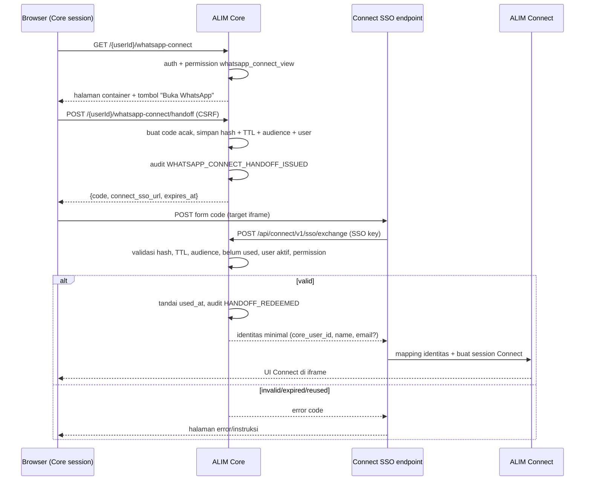

# Desain Integrasi WhatsApp Connect di ALIM Core

> **Desain saja.** Tidak ada kode, route, migration, konfigurasi, atau data yang diubah.
>
> Target: pengguna ALIM Core dapat membuka WhatsApp Connect di halaman terintegrasi, dengan **iframe + SSO handoff** dan fallback tab baru.
>
> ALIM Connect tetap aplikasi terpisah. Core tidak membagikan session cookie dan tidak menjadi sumber otorisasi internal Connect.

## 1. Kondisi Aktual ALIM Core

### 1.1 Autentikasi dan session

Bukti:

- Route login/logout: `routes/web.php:467–469`.
- `Auth\LoginController::logout()`: `Auth::logout()`, `session()->invalidate()`, `session()->regenerateToken()` (`app/Http/Controllers/Auth/LoginController.php:289–306`).
- `AuthenticatedSessionController` juga melakukan invalidasi session.
- Session config: `config/session.php` — driver `database` default, lifetime 120, cookie `laravel_session`, `domain` dari `SESSION_DOMAIN` (aktif: `null`), `SameSite=lax`, `HttpOnly=true`.
- `.env` aktif: `SESSION_DRIVER=file`, `SESSION_LIFETIME=1200`, `SESSION_DOMAIN=null`, `SESSION_SECURE_COOKIE=false`, `SESSION_SAME_SITE=lax`.

Implikasi:

- Core memakai **session cookie host-only**.
- Tidak ada SSO/OIDC/OpenID saat ini.
- Core tidak boleh mengirim cookie session ke Connect.
- Untuk iframe lintas origin, cookie Connect tidak otomatis aktif; perlu token handoff.

### 1.2 Middleware autentikasi/otorisasi

Bukti: `app/Http/Kernel.php:98–127`.

Grup `web` memuat:

- `StartSession`
- `AuthenticateSessionSecure`
- `WebSecurityHeaders`
- `VerifyCsrfToken`
- `SchoolContextMiddleware`
- `BindOrganizationContext`
- `CheckIpBlocked`
- `EnsureStudentPasswordChanged`
- dan middleware keamanan lain.

Grup route user (`routes/web.php:597–600`) memakai:

```text
auth, employee.access, role.access, school.context, organization.context
```

`permission` / `permission-all` tersedia melalui `RequirePermission` (`app/Http/Middleware/RequirePermission.php`). Helper `canPermission()` membutuhkan `OrganizationContext` yang sudah dibinding.

Implikasi:

- Halaman baru harus berada di grup `user` agar session, context, dan RBAC aktif.
- Pemeriksaan permission harus server-side, bukan hanya menyembunyikan menu.

### 1.3 RBAC dan permission

Bukti:

- Spatie Permission + custom `App\Models\Role`/`Permission`.
- `canPermission()` di `app/Authorization/helpers.php:23–61`.
- `menu_allowed()` di `app/Authorization/helpers.php:220–247`.
- `SidebarAccess` menyimpan `allowed_roles` dan `canAccessByRoles()` (`app/Models/SidebarAccess.php`).
- `AuthorizationManager` + `SnapshotResolver` + `permission_snapshots` untuk permission berbasis assignment/domain.
- `User::isSystemAdmin()`/`isSuperAdmin()` bypass.

Implikasi:

- Permission baru harus masuk katalog `permissions` dan diberikan melalui role/assignment, bukan hardcode nama jabatan.
- `SidebarAccess` berbasis role dapat dipakai sebagai filter tampilan, tetapi **bukan** pengganti otorisasi route.

### 1.4 Menu dan sidebar

Bukti:

- Layout utama: `resources/views/layouts/master.blade.php` memuat `layouts.topbar`, `layouts.sidebar`, dan `@yield('content')`.
- `resources/views/layouts/sidebar.blade.php` adalah dispatcher; memilih sidebar per role/jabatan/tugas.
- Sidebar role ada di `resources/views/layouts/sidebar/{role}/sidebar.blade.php`.
- Menu tertentu memakai `canPermission(...)`; menu lain memakai `$hasRole`, `$hasJabatan`, `$hasTugas`.
- `SidebarAccessComposer` membagikan `$sidebarAccesses`; Blade directive `@menuallowed` memakai `menu_allowed()`.

Implikasi:

- Menu WhatsApp Connect harus ditambahkan pada sidebar yang relevan dengan `@if(canPermission('whatsapp_connect_view'))`, bukan berdasarkan teks jabatan.
- Layout halaman baru harus extend `layouts.master` agar topbar/sidebar tetap konsisten.

### 1.5 CSP dan security headers

Bukti:

- `WebSecurityHeaders` (grup `web`) mengirim `X-Frame-Options: SAMEORIGIN` dan **CSP report-only** dengan `frame-ancestors 'self'`, tanpa `frame-src`.
- `SecurityHeadersMiddleware` (grup `api`) mengirim CSP enforced dengan `default-src 'self'` dan `frame-ancestors 'self'`.
- Belum ada `frame-src` khusus Connect.

Implikasi:

- Secara aktual, halaman web Core belum dibingkai oleh iframe; `X-Frame-Options` Core tidak menghalangi Core membingkai Connect.
- Yang menentukan iframe berhasil adalah **response Connect**: `Content-Security-Policy: frame-ancestors <origin Core>` dan tidak adanya `X-Frame-Options: DENY`.
- Namun CSP Core perlu `frame-src` untuk origin Connect agar tidak melanggar ketika enforcement diaktifkan.
- Jangan memakai wildcard.

### 1.6 Logout dan session lifecycle

Bukti:

- Logout Core menghapus session Core dan regenerate CSRF.
- `LoginActivityLogger` mencatat `logout` (`app/Http/Controllers/Auth/LoginController.php:294`).
- Tidak ada mekanisme logout lintas aplikasi ke Connect.

Implikasi:

- Logout Core tidak otomatis mengakhiri session Connect di iframe.
- Perlu kebijakan: logout Connect eksplisit, session Connect lebih pendek, atau single logout via API/postMessage.

### 1.7 Audit aktivitas

Bukti:

- `AuditLog` (`app/Models/AuditLog.php`) memiliki `user_id`, `action`, `table_name`, `record_id`, `request_id`, `metadata`.
- `LoginActivityLogger` (`app/Services/Security/LoginActivityLogger.php`) mencatat login/logout.
- `AuditLog` dipakai modul lain; belum ada event handoff SSO.

Implikasi:

- Penerbitan dan penukaran handoff harus menulis audit Core, tanpa menyimpan kode/token mentah.

### 1.8 Domain dan environment

Bukti:

- `config/app.php:122` — `APP_URL`.
- `config/trustedhost.php` + `TrustHosts` — host allowlist.
- `config/cors.php` — hanya `api/*` dan `sanctum/csrf-cookie`, `supports_credentials=true`.
- Tidak ada konfigurasi origin Connect saat ini.

Implikasi:

- Origin Connect harus dikonfigurasi eksplisit per environment.
- CORS browser bukan pengganti SSO; pertukaran handoff harus server-side.

## 2. Arsitektur Integrasi yang Direkomendasikan

### 2.1 Komponen

```text
Browser (session Core)
  → Halaman Core /{userId}/whatsapp-connect
    → cek auth + permission whatsapp_connect_view
    → minta handoff code (POST, CSRF)
      → Core ConnectHandoffService: buat code acak, simpan hash, TTL pendek, audit
    → form POST code ke Connect /sso/handoff (target iframe)
      → Connect server memanggil Core POST /api/connect/v1/sso/exchange
        → Core validasi code (hash, TTL, audience, one-time, user aktif, permission)
        → Core tandai used_at, audit, kembalikan identitas minimal
      → Connect memetakan identitas ke user Connect
      → Connect membuat session Connect sendiri
    → iframe menampilkan UI Connect
```

### 2.2 Prinsip

1. **Core tetap sumber autentikasi Core**; Connect tetap sumber session/RBAC Connect.
2. **Tidak ada sharing cookie** Core ke Connect.
3. **Tidak mengirim role/jabatan/unit sebagai otoritas Connect**; hanya identitas minimal.
4. **One-time code** berumur pendek, disimpan sebagai hash, dan tidak ditaruh di URL.
5. **Least privilege**: permission Core hanya untuk membuka halaman/handoff.
6. **Fallback** tab baru tetap tersedia.

### 2.3 Rekomendasi jalur

- **Utama:** iframe + one-time code + server-side exchange.
- **Fallback:** tombol “Buka WhatsApp di tab baru” dengan mekanisme POST form, bukan query token.
- **Jangka panjang:** jika cookie pihak ketiga menghambat, pertimbangkan reverse proxy same-origin `/connect/*`.

## 3. Diagram Alur SSO



## 4. Kontrak Handoff Core ↔ Connect

### 4.1 Penerbitan handoff (Core, web session)

`POST /{userId}/whatsapp-connect/handoff`

- Middleware: `auth`, `employee.access`, `role.access`, `school.context`, `organization.context`, `permission:whatsapp_connect_view`.
- CSRF wajib.
- Rate limit per user/IP.

Response:

```json
{
  "success": true,
  "data": {
    "code": "base64url-random-32-bytes",
    "audience": "connect",
    "scope": ["whatsapp.embed"],
    "expires_at": "2026-11-22T10:01:00+08:00",
    "connect_sso_url": "https://connect.example.com/sso/handoff"
  },
  "meta": {"timestamp": "2026-11-22T10:00:00+08:00"},
  "errors": null
}
```

Aturan:

- Code 32 byte acak; disimpan `hash('sha256', code)`, bukan plaintext.
- TTL 60 detik (dapat dikonfigurasi 30–120 detik).
- Terikat `user_id`, `audience=connect`, `scope=whatsapp.embed`, `expires_at`.
- Satu code hanya untuk satu penukaran.
- Audit penerbitan tanpa menyimpan code.

### 4.2 Penukaran handoff (Core, service-to-service)

`POST /api/connect/v1/sso/exchange`

Header:

```text
X-ALIM-CONNECT-SSO-KEY: <key>
```

Payload:

```json
{
  "code": "base64url-random-32-bytes",
  "audience": "connect",
  "state": "optional-correlation-id"
}
```

Response sukses:

```json
{
  "success": true,
  "data": {
    "core_user_id": "uuid",
    "name": "Nama Pengguna",
    "email": "user@example.test",
    "audience": "connect",
    "scope": ["whatsapp.embed"],
    "issued_at": "2026-11-22T10:00:00+08:00",
    "redeemed_at": "2026-11-22T10:00:05+08:00"
  },
  "meta": {"timestamp": "2026-11-22T10:00:05+08:00"},
  "errors": null
}
```

Aturan:

- Exchange hanya server-side; jangan panggil dari browser.
- Core memvalidasi ulang `user.is_active` dan permission `whatsapp_connect_view` saat exchange.
- Core **tidak** mengirim role/jabatan/unit sebagai otoritas.
- `used_at` diisi atomik; dua exchange paralel → hanya satu sukses.
- `audience` harus cocok.
- Error: 401 key, 403 audience/scope/permission, 404/410 code invalid/expired, 409 code used, 422 payload.

### 4.3 Error contract

| HTTP | Code | Arti |
|---|---|---|
| 401 | `invalid_sso_key` | Key tidak valid |
| 403 | `insufficient_scope` | Key tidak punya `sso:exchange` |
| 403 | `audience_mismatch` | Audience bukan `connect` |
| 403 | `user_inactive` | User Core nonaktif |
| 403 | `permission_revoked` | Permission Core dicabut |
| 404 | `code_not_found` | Code tidak dikenal |
| 410 | `code_expired` | Code kedaluwarsa |
| 409 | `code_already_used` | Code sudah dipakai |
| 422 | `invalid_payload` | Payload tidak valid |

### 4.4 Pemetaan identitas

- Core mengirim `core_user_id` (UUID) sebagai identitas kanonik.
- Connect memetakan ke user Connect melalui tabel mapping milik Connect.
- Bila belum terpetakan → Connect menampilkan error `identity_not_mapped`; Core tidak membuat user Connect.
- Email/nama hanya atribut tampilan/awal, bukan dasar otorisasi.

### 4.5 Logout dan expiry

- Core logout hanya mengakhiri session Core.
- Connect harus menyediakan logout/session expiry sendiri.
- Rekomendasi: tombol “Keluar dari WhatsApp” di halaman Core memanggil endpoint logout Connect di tab/iframe yang sama, lalu menampilkan status.
- Alternatif: session Connect lebih pendek (mis. 30–60 menit) dan iframe memeriksa status saat fokus.
- Jangan mengandalkan `postMessage` tanpa verifikasi origin.

## 5. Desain RBAC dan Permission

### 5.1 Permission baru

Usulan nama: **`whatsapp_connect_view`**.

- Ditambahkan ke katalog `permissions` melalui `PermissionSeeder` (aditif).
- Diberikan hanya kepada role/assignment yang disetujui pemilik sistem.
- Tidak otomatis ke semua user.
- Tidak memakai teks jabatan.
- Route dan menu memakai permission yang sama.

### 5.2 Pemeriksaan

- Menu: `@if(canPermission('whatsapp_connect_view'))`.
- Route: middleware `permission:whatsapp_connect_view`.
- Handoff: cek ulang permission di controller/service dan saat exchange.
- Connect tetap menjalankan RBAC sendiri.

### 5.3 Hubungan dengan Connect

- Core permission hanya gerbang menuju halaman/handoff.
- Connect harus memutuskan apakah user boleh melihat inbox/percakapan berdasarkan RBAC Connect.
- User yang punya akses Core tetapi tidak terpetakan/berhak di Connect akan menerima error dari Connect.
- Jangan menyamakan role Core dan role Connect.

## 6. Desain CSP dan Keamanan Iframe

### 6.1 Core

- Tambahkan `frame-src` **hanya** pada response halaman WhatsApp Connect (route-specific header) atau konfigurasi CSP terpusat:
  - `frame-src 'self' https://connect.example.com;`
- Jangan mengubah `default-src` menjadi wildcard.
- Jangan menghapus `X-Frame-Options: SAMEORIGIN` dari response Core umum.
- `connect-src` perlu mengizinkan WebSocket/HTTP Connect bila iframe membutuhkannya.
- Origin berbeda per environment (dev/staging/prod).

### 6.2 Connect

- Response halaman embed harus mengirim:
  - `Content-Security-Policy: frame-ancestors https://core.example.com;`
  - `X-Frame-Options` tidak boleh `DENY`; jika dipertahankan, gunakan `SAMEORIGIN` hanya untuk same-origin.
- Jangan `frame-ancestors *`.
- Pertahankan CSP internal Connect; jangan melemahkan `script-src`/`default-src`.
- Pastikan endpoint SSO dan UI tidak membocorkan code/token di URL, history, atau Referer.

### 6.3 Cookie

- Cross-site iframe dapat memblokir cookie pihak ketiga.
- Jika Connect memakai cookie session:
  - `Secure`
  - `HttpOnly`
  - `SameSite=None` untuk cross-site (dengan konsekuensi keamanan)
  - pertimbangkan `Partitioned` (CHIPS) bila didukung.
- Jika cookie pihak ketiga tidak dapat diandalkan, pertimbangkan reverse proxy same-origin.
- Jangan memakai `SameSite=Lax` untuk session Connect di iframe cross-site.

## 7. Komponen Core yang Perlu Diubah

| Komponen | Perubahan |
|---|---|
| Migration | Tabel `connect_sso_handoffs` (additive) |
| Model | `ConnectSsoHandoff` |
| Service | `ConnectHandoffService` (issue/redeem, hash, TTL, atomic used_at, audit) |
| Controller web | `WhatsAppConnectController` (halaman, issue handoff) |
| Controller API | `ConnectSsoExchangeController` |
| Request | `IssueConnectHandoffRequest`, `ExchangeConnectHandoffRequest` |
| Middleware | `VerifyConnectSsoApiKey` + alias |
| Config | `config/services.php` blok `connect_sso`; env `CONNECT_SSO_*` |
| Permission | `whatsapp_connect_view` di `PermissionSeeder` |
| Sidebar | Menu pada sidebar role terkait dengan `canPermission` |
| Blade | `resources/views/whatsapp-connect/index.blade.php` extends `layouts.master` |
| Security header | `frame-src` route-specific untuk Connect |
| Audit | Event issue/redeem/gagal |
| Routes | Web route dalam grup `user`; API route baru di `/api/connect/v1/sso/exchange` |

### 7.1 Tabel handoff (usulan)

```text
connect_sso_handoffs
  id uuid PK
  code_hash char(64) unique
  user_id uuid FK users cascadeOnDelete
  audience varchar(32)
  scope varchar(100) nullable
  expires_at timestamp
  used_at timestamp nullable
  used_ip varchar(45) nullable
  used_user_agent varchar(255) nullable
  created_at timestamp
```

- `code_hash` unique.
- Index `(user_id, created_at)`, `(expires_at)`.
- Tidak menyimpan code plaintext.
- Retensi: hapus setelah 24 jam/7 hari (job terpisah).

## 8. Tanggung Jawab ALIM Connect

Connect harus menyediakan:

1. `POST /sso/handoff` (menerima code via form body, bukan URL).
2. Verifikasi code ke Core `POST /api/connect/v1/sso/exchange` (server-side).
3. Pemetaan identitas Core → user Connect.
4. Session Connect sendiri; logout/expiry.
5. `frame-ancestors` Core.
6. RBAC Connect; tidak memakai role Core.
7. Error `identity_not_mapped`, `session_expired`, `invalid_handoff`.
8. UI yang responsif untuk iframe.
9. Endpoint/logout untuk single logout bila disepakati.
10. Tidak mengakses database Core.

## 9. Skenario Pengujian dan Kriteria Penerimaan

| ID | Skenario | Ekspektasi |
|---|---|---|
| SSO-01 | User belum login membuka halaman | Redirect login |
| SSO-02 | Login tanpa permission | 403 |
| SSO-03 | Login dengan permission | Halaman tampil, handoff bisa dibuat |
| SSO-04 | Handoff expired | 410/`code_expired` |
| SSO-05 | Handoff dipakai dua kali | Satu sukses, kedua 409/`code_already_used` |
| SSO-06 | Audience salah | 403/`audience_mismatch` |
| SSO-07 | Code dimanipulasi | 404/422 |
| SSO-08 | Identitas belum dipetakan di Connect | Error `identity_not_mapped` |
| SSO-09 | Session Connect expired | Connect meminta handoff ulang |
| SSO-10 | Logout Core | Session Core berakhir; iframe tidak lagi dapat mengakses Core |
| SSO-11 | Logout Connect | Session Connect berakhir; Core tetap login |
| SSO-12 | Origin iframe tidak diizinkan | Browser menolak frame (CSP) |
| SSO-13 | Buka URL Connect langsung tanpa SSO | Ditolak/redirect SSO |
| SSO-14 | Fallback tab baru | Code tetap one-time; tidak ada token di URL |
| SSO-15 | Permission dicabut setelah issue | Exchange gagal `permission_revoked` |
| SSO-16 | Concurrent exchange | Hanya satu sukses |
| SSO-17 | Audit | Issue/redeem/gagal tercatat tanpa code mentah |

Kriteria penerimaan:

- Tidak ada cookie Core yang dikirim ke Connect.
- Tidak ada code/token di URL, history, Referer, atau log aplikasi.
- `frame-ancestors` hanya origin Core.
- Permission Core dan RBAC Connect sama-sama diperiksa.
- Fallback tab baru berfungsi.
- Tidak ada akses langsung yang melewati SSO.

## 10. Risiko, Dependensi, dan Keputusan yang Diperlukan

### 10.1 Risiko

| Risiko | Dampak | Mitigasi |
|---|---|---|
| Cookie pihak ketiga diblokir | Session Connect tidak terbentuk di iframe | SSO token, SameSite=None/Partitioned, atau reverse proxy |
| CSP Connect menolak iframe | Halaman kosong | `frame-ancestors` exact origin + test browser |
| Code bocor | Pengambilalihan session | TTL 60s, one-time, hash, POST body, no URL |
| Identity mapping salah | User melihat data orang lain | Mapping eksplisit + verifikasi; no role sharing |
| Logout tidak sinkron | Session Connect tetap hidup | Logout Connect/session pendek |
| Permission baru terlalu luas | Akses tidak sah | Least privilege; assignment/role review |
| Origin dev/staging salah | Iframe gagal | Config per environment |
| Reverse proxy/WebSocket | UI tidak real-time | Uji proxy upgrade/WS |
| Connect belum punya endpoint SSO | Tidak bisa mulai | Kontrak harus disepakati lebih dulu |

### 10.2 Dependensi

1. Kontrak SSO Core–Connect disetujui.
2. Connect menyediakan endpoint exchange/verification dan mapping identity.
3. Connect mengubah `frame-ancestors`/XFO.
4. Kebijakan permission `whatsapp_connect_view`.
5. Kebijakan logout/session Connect.
6. Origin per environment.
7. Audit retention.
8. Uji browser (Chrome/Safari/Firefox) untuk cookie iframe.

### 10.3 Keputusan yang masih diperlukan

1. Nama/level permission: `whatsapp_connect_view`?
2. Siapa role/pengguna yang mendapat permission?
3. TTL handoff: 60 detik?
4. Apakah memakai iframe cross-origin atau reverse proxy same-origin?
5. Kebijakan logout: single logout atau session pendek?
6. Apakah email/nama dikirim saat exchange?
7. Apakah Connect memakai cookie session atau token internal?
8. Retensi `connect_sso_handoffs` dan audit.
9. Apakah perlu `postMessage` untuk resize/logout; origin validation.
10. Apakah fallback tab baru wajib untuk semua user atau hanya jika iframe gagal.

### 10.4 Batas

Dokumen ini tidak mengubah kode, migration, route, konfigurasi, atau data. Implementasi memerlukan persetujuan terpisah dan kontrak yang disepakati dengan ALIM Connect.
